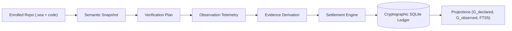

# RealityTrace / Semantic Exhaust Runtime (SXR)

> **Work from evidence, not appearance.**  
> *Cryptographic observation, evidence derivation, and threshold settlement engine for autonomous software engineering.*

---

## What is SXR?

**SXR (Semantic Exhaust Runtime)** is an append-only, cryptographic audit and settlement runtime for software verification and autonomous developer agents.

It captures the semantic exhaust emitted during software engineering activities, enforces closed Common Event Protocol (CEP-0008) envelope validation, guarantees dense SHA-256 hash-chain durability in an isolated SQLite ledger, maintains derived relational and graph read-models ($G_{declared}$, $G_{observed}$), and executes an asymmetric 9-locus diagnostic attribution loop that prevents agents from prematurely refactoring high-level models when infrastructure or test runners fail.



---

## Quick Navigation

The repository is documented as a self-contained progressive-disclosure knowledge system:

| I Want To... | Link |
| :--- | :--- |
| **Get an Overview & Orientation** | [Layer 0: Orientation Portal](./docs/index.md) |
| **Understand the Mental Model** | [Layer 1: Epistemic Mental Model](./docs/mental-model.md) |
| **Inspect System Architecture** | [Architecture Specification](./architecture.md) & [Logical Architecture](./docs/architecture/logical.md) |
| **Follow a Step-by-Step Hands-On Guide** | [Quickstart Tutorial](./docs/tutorials/quickstart.md) |
| **Study Subsystems & Crates** | [Subsystems Directory](./docs/subsystems/sxr-core.md) |
| **Trace End-to-End Workflows** | [Execution Traces & Workflows](./docs/workflows/verification-run.md) |
| **Understand Why It Was Built This Way** | [Explanation & Anti-Collapse Epistemology](./docs/explanation/anti-collapse-epistemology.md) |
| **Look Up CLI Commands & Schemas** | [CLI Manual](./docs/reference/cli.md) & [Schemas Reference](./docs/reference/schemas.md) |
| **Find Code Symbols & Invariants** | [Source Traceability Map](./source-map.md) |
| **View the Full Documentation Blueprint** | [Documentation Map](./documentation-map.md) |

---

## Workspace Crates

- [`sxr-core`](./docs/subsystems/sxr-core.md): Zero-I/O domain kernel, CEP-0008 validator, 26-record registry, and threshold algebra.
- [`sxr-ledger`](./docs/subsystems/sxr-ledger.md): SQLite append-only storage, hash chaining, writer flock, outbox, and commit queue.
- [`sxr-git`](./docs/subsystems/sxr-git.md): Git discovery port and minted ULID identity management.
- [`sxr-df`](./docs/subsystems/sxr-df.md): DomainForge semantic source adapter for `.sea` models.
- [`sxr-verify`](./docs/subsystems/sxr-verify.md): Verifier port executing test runners (e.g. `cargo-test`) and streaming JSON output.
- [`sxr-cli`](./docs/subsystems/sxr-cli.md): Unified CLI binary, projections engine, and background daemon service.
- [`ablation`](./docs/subsystems/ablation.md): Scientific study and empirical hypothesis attribution harness.

---

## Quickstart

```bash
# Build SXR
cargo build -p sxr-cli
export PATH="$PWD/target/debug:$PATH"

# Check system health
sxr doctor --json

# Enroll your repository
sxr repo enroll /path/to/my-repo --json

# List enrolled repositories
sxr repo list --json
```

For the complete end-to-end verification and settlement walkthrough, see the [Quickstart Tutorial](./docs/tutorials/quickstart.md).

---

## License

Dual-licensed under MIT or Apache-2.0.
