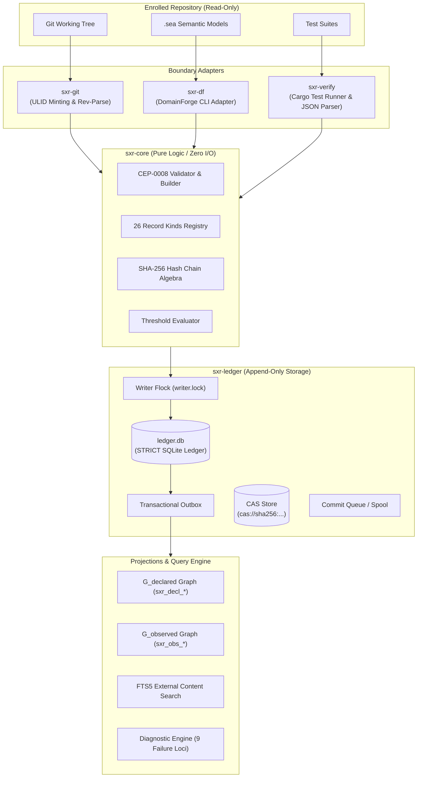

# RealityTrace Architecture Specification

## 1. System Identity and Purpose

**RealityTrace** (engine codename **SXR** — Semantic Exhaust Runtime) is the cryptographic observation-evidence-settlement engine developed at `GodSpeedAI/RealityTrace`.

### Core Purpose
In contemporary agentic software engineering and verification pipelines, systems frequently fall into **epistemic collapse traps**:
1. Confusing execution telemetry (raw test outputs, compiler outputs) with proof.
2. Silently rewriting history when tests fail or are retried.
3. Conflating assertions (claims) with evidenced facts.
4. Prematurely blaming upstream domain models for failures caused by faulty verifiers or environmental flakes.
5. Granting settlement status without explicit, pre-declared threshold contracts.

SXR solves this by acting as an **append-only, cryptographic audit and settlement runtime**. It captures the semantic exhaust of software engineering activities, validates every event against a closed **Common Event Protocol (CEP-0008)** envelope schema, enforces dense hash-chain durability in an isolated SQLite ledger, derives separate relational and graph projections ($G_{declared}$, $G_{observed}$), and executes an asymmetric 9-locus diagnostic loop before permitting model-level repair proposals.

---

## 2. The System in One Picture

The diagram below illustrates the end-to-end logical flow of data through SXR:

---

## 3. Epistemological Anti-Collapse Axioms

SXR is constructed on rigid epistemological boundaries defined in **CEP-0008 §53**. The runtime enforces structural distinctions so that concepts cannot be collapsed:

1. **Data is not Evidence**: Raw execution data (e.g. stdout from `cargo test`) is an *observation*, not evidence. It only becomes *evidence* when paired with a target claim/question, a declared derivation rule, relevance, reliability, and direction (`supports` vs `contradicts`).
2. **Representation is not Reality**: Code and `.sea` models are *representations* of intent. When DomainForge fails to construct a valid semantic snapshot, SXR records an explicit `OmissionRecord` (`invalid_declared_checkpoint_hash`) rather than pretending reality conforms to the text.
3. **Action is not Transformation**: Executing a plan is an *action*; only the verified, evidenced difference in state constitutes a *transformation*.
4. **Completion is not Settlement**: A test suite finishing with exit code `0` is mere *completion*. *Settlement* requires deterministic evaluation against a strictly earlier declared threshold (e.g., `AllEvidenceSupports`).
5. **Assertion is not Evidenced Fact**: A claim made (`claim.made`) asserts a relationship, but an edge in the observed graph ($G_{observed}$) is admitted **only** when qualifying evidence explicitly targets that claim meeting the question's threshold. Co-reference never creates an edge.

---

## 4. Architectural Layers

### Layer 1: Pure Domain & Cryptography (`sxr-core`)
- **Zero I/O Invariant**: Must never perform disk I/O, network calls, process spawning, or SQLite access (AC-CORE-001).
- **Entities**:
  - `RepoIdentity`: Minted ULID identity (`repo_id`, `checkout_id`).
  - `DeclKey`: Deterministic declaration keys (`concept:`, `application:`, `occurrence:`).
  - `RecordKind`: 26 closed record kinds statically compiled from `record_kinds.csv`.
  - `LedgerRow`: The immutable 15-field ledger record.
  - `chain`: Dense SHA-256 hash chaining ($h_n = \text{SHA256}(\text{canonical\_json}(\text{row}_n))$).
  - `threshold`: Settlement evaluation logic (`AllEvidenceSupports`, `AnyEvidenceContradicts`, `RequiresEvidence`).
  - `proof_ingest` / `evidence_emit`: Convergence gates E7 and E8 between RealityTrace, SWE_SEED, and GodSpeed-Agent.

### Layer 2: Durable Append-Only Storage (`sxr-ledger`)
- **Storage Substrate**: SQLite with `STRICT` tables and `WAL` mode.
- **Append-Only Ledger**: The `ledger` table records gapless `append_ordinal` (1-indexed) where each row binds `previous_entry_hash` to the prior entry's `entry_hash`.
- **Concurrency & Locking**: File locking (`writer_lock.rs`) using OS `flock` ensures a single writer process at any time (timeout: 30s).
- **Transactional Outbox**: Atomic insertion of rows into `outbox` alongside the ledger append, allowing asynchronous projectors to drain and track watermarks (`projection_watermark`).
- **Large Payloads**: Content-Addressable Storage (`cas/`) stores representations exceeding size thresholds, referenced via `cas://sha256:<hex>` URIs.

### Layer 3: System Adapters (`sxr-git`, `sxr-df`, `sxr-verify`)
- **`sxr-git`**: Resolves repository checkout status via `git rev-parse` and mints fresh ULID identities. Minted IDs are never derived from Git properties (AC-IDENTITY-001).
- **`sxr-df`**: Implements `SemanticSourcePort` over the `domainforge` binary, parsing `.sea` files and producing structured snapshots or explicit omission records.
- **`sxr-verify`**: Implements `VerifierPort` by running external verification suites (specifically `cargo test --message-format json`), streaming JSON records into observations without making premature evidence or settlement claims.

### Layer 4: Orchestration, Projections & Daemon (`sxr-cli`)
- **CLI Commands**: Unified entry point for repo enrollment, snapshotting, runs, verifications, evidence derivation, settlements, diagnostics, and projections.
- **Projections Engine**: Rebuilds relational tables ($G_{declared}$ from snapshots, $G_{observed}$ from evidenced claims, FTS5 external content index) in predecessor-chain order, guaranteeing byte-identical canonical JSON export across rebuilds (AC-REPLAY-002).
- **Diagnostic Attribution Loop (Slice 5)**: When a run contradicts declared semantics, SXR isolates the failure locus across 9 candidate categories (e.g. `verifier`, `environment`, `declared_model`), enforcing that cheap non-model loci must be evidence-excluded before a model repair proposal can be raised (AC-DIAG-001).
- **Optional Background Daemon (Slice 6)**: UNIX domain socket service accepting envelope submissions, fsyncing segments into a durable commit queue, and committing in batches. Direct CLI commits and daemon commits maintain complete byte-for-byte record parity (AC-DAEMON-001).

---

## 5. Subsystems Index

| Subsystem | Primary Role | Crate Path | Deep Guide |
| :--- | :--- | :--- | :--- |
| **Domain Logic** | Types, envelope schema, hash chain formulas, threshold math | `sxr-core` | [`docs/subsystems/sxr-core.md`](./docs/subsystems/sxr-core.md) |
| **Storage Engine** | SQLite ledger, writer flock, outbox, CAS, commit queue | `sxr-ledger` | [`docs/subsystems/sxr-ledger.md`](./docs/subsystems/sxr-ledger.md) |
| **Git Discovery** | ULID identity minting, rev-parse discovery, continuity | `sxr-git` | [`docs/subsystems/sxr-git.md`](./docs/subsystems/sxr-git.md) |
| **DomainForge Adapter** | SemanticSourcePort, .sea model resolution, snapshots | `sxr-df` | [`docs/subsystems/sxr-df.md`](./docs/subsystems/sxr-df.md) |
| **Verifier Runner** | VerifierPort, cargo-test execution, JSON streaming | `sxr-verify` | [`docs/subsystems/sxr-verify.md`](./docs/subsystems/sxr-verify.md) |
| **CLI & Runtime** | Commands, projections, daemon, diagnostics, state | `sxr-cli` | [`docs/subsystems/sxr-cli.md`](./docs/subsystems/sxr-cli.md) |
| **Scientific Ablation** | Empirical hypothesis attribution harness, evidence revisions | `ablation/` | [`docs/subsystems/ablation.md`](./docs/subsystems/ablation.md) |

---

## 6. Runtime Boundaries and Data Storage

### Sandboxed Storage (AC-SECURITY-001)
SXR **never writes inside the enrolled repository**. All persistent state resides under standard XDG paths:
- Data Root: `$XDG_DATA_HOME/sxr` (defaults to `~/.local/share/sxr`)
  - `repos/<repo_id>/registry.json` — Enrolled repository metadata.
  - `repos/<repo_id>/semantic.json` — Semantic namespace configurations.
  - `repos/<repo_id>/ledger.db` — SQLite database holding `ledger`, `outbox`, and projections.
  - `repos/<repo_id>/writer.lock` — Advisory flock file for write serialization.
  - `repos/<repo_id>/cas/` — Content-Addressable Storage for representation files.
- State Root: `$XDG_STATE_HOME/sxr` (defaults to `~/.local/state/sxr`)
  - `daemon-queue/<repo_id>/` — Fsynced segments of the durable commit queue.
  - `spool/<repo_id>/` — Opt-in unvalidated request spool.
- Runtime Socket: `$XDG_RUNTIME_DIR/sxr.sock` (or `/tmp/sxr.sock`, overridable via `SXR_DAEMON_SOCKET`).

---

## 7. Important Invariants

| Invariant Code | Definition | Enforcement Location |
| :--- | :--- | :--- |
| **AC-CORE-001** | `sxr-core` must remain pure data and pure functions; no file system, network, or SQLite I/O. | `sxr-core/Cargo.toml`, compile-time enforcement |
| **AC-SECURITY-001**| `sxr` commands must never create, modify, or delete files inside the enrolled repository checkout. | `sxr-cli/src/state.rs`, verified by `proof/gate1.sh` |
| **AC-IDENTITY-001**| Repository and checkout identities are ULIDs minted at enrollment, never derived from Git properties. | `sxr-git/src/identity.rs` |
| **AC-IDENTITY-002**| The same declaration identity in two separate checkouts remains disjoint; graphs are partitioned. | `sxr-cli/src/projections.rs`, verified by `proof/slice3.sh` |
| **AC-LEDGER-001** | Ledger hash chains must be strictly dense, gapless, and verify $h_n = \text{SHA256}(\text{canonical}(\text{row}_n))$. | `sxr-core/src/chain.rs`, `sxr-ledger/src/ledger.rs` |
| **AC-SETTLEMENT-002**| A validation-failed model settles the validity question as failed or blocked; positive acceptance is forbidden. | `sxr-core/src/threshold.rs:authorize_settlement` |
| **AC-GRAPH-001**   | Observed graph ($G_{observed}$) edges require explicit qualifying evidence targeting a claim; co-reference never creates an edge. | `sxr-cli/src/projections.rs`, verified by `proof/slice4.sh` |
| **AC-DIAG-001**    | Model-locus proposals are rejected until all cheaper failure loci (verifier, environment, etc.) are evidence-excluded. | `sxr-cli/src/commands.rs:diagnostic_propose`, verified by `proof/slice5.sh` |
| **AC-DAEMON-001**  | Identical runs executed direct vs via daemon produce byte-identical ledger and projection exports. | `sxr-cli/src/daemon.rs`, verified by `proof/slice6.sh` |
| **AC-REPLAY-002**  | Projections rebuilt via `projections rebuild --all` produce byte-identical canonical JSON export. | `sxr-cli/src/projections.rs`, verified by `proof/gate1.sh` |
