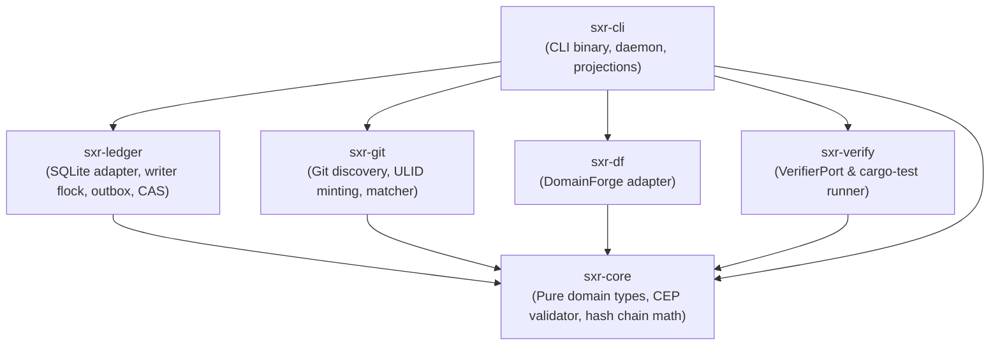

# Dependency Architecture

SXR's dependency architecture is strictly stratified to enforce compilation boundaries, isolate I/O from pure domain logic, and support air-gapped or offline execution.

---

## 1. Crate Dependency DAG

---

## 2. Invariant Rules per Crate

### Rule 1: `sxr-core` has Zero I/O Dependencies (AC-CORE-001)
`sxr-core` is the mathematical and protocol kernel of the system.
- **Allowed**: `serde`, `serde_json`, `sha2`, `hex`, `uuid`, `chrono`, `jsonschema`, `thiserror`.
- **Forbidden**: `rusqlite`, `libc`, `tempfile`, `std::fs`, `std::net`, `std::process`.
- Any attempt to add I/O or SQLite dependencies to `sxr-core` breaks compilation tests (`tests/ac_core_001.rs`).

### Rule 2: Peripheral Crates are Domain-Isolated
- **`sxr-git`**: Interacts with Git exclusively via command spawning (`git rev-parse`, `git status`). It does not use `git2` or C bindings to ensure clean behavior across diverse Git versions.
- **`sxr-df`**: Interacts with DomainForge via external binary execution (`domainforge`), parsing JSON representations without coupling to DomainForge compiler internals.
- **`sxr-verify`**: Interacts with verifiers (like `cargo`) via standard process execution and streams JSON events through `cargo-json.rs`.
- **`sxr-ledger`**: Encapsulates all SQLite I/O (`rusqlite`) and POSIX file locking (`libc::flock`).

### Rule 3: `sxr-cli` Unifies and Orchestrates
`sxr-cli` is the only crate that depends on all other workspace crates. It manages user interaction (`clap`), state files (`state.rs`), background daemon IPC (`daemon.rs`), and relational table projections (`projections.rs`).

---

## 3. External Dependency Footprint

All external workspace dependencies are pinned at exact or compatible versions in the root `Cargo.toml`:

| Dependency | Version | Purpose |
| :--- | :--- | :--- |
| `serde` / `serde_json` | `1.0` | High-performance JSON serialization and deserialization |
| `sha2` / `hex` | `0.10` / `0.4` | SHA-256 cryptographic hashing for envelopes and hash chains |
| `uuid` | `1.19` (`features = ["v7"]`) | Time-ordered UUIDv7 minting for runtime envelopes |
| `ulid` | `1.1` (`features = ["serde"]`) | Lexicographically sortable 128-bit unique identifiers |
| `chrono` | `0.4` | Microsecond-precision RFC 3339 timestamps |
| `jsonschema` | `0.18` | In-memory validation of envelopes against embedded JSON Schemas |
| `thiserror` / `anyhow` | `2.0` / `1.0` | Structured error typing in libraries; context handling in CLI |
| `rusqlite` | `0.32` | SQLite storage engine with STRICT and WAL support |
| `clap` | `4.x` | Command-line parsing and help generation |
| `libc` | `0.2` | POSIX `flock` bindings for advisory write locking |

---

## 4. Source Trail

- [`Cargo.toml`](file:///home/sprime01/projects/sxr/Cargo.toml) — Root workspace dependencies and profile configurations.
- [`sxr-core/Cargo.toml`](file:///home/sprime01/projects/sxr/sxr-core/Cargo.toml) — Pure dependencies for `sxr-core`.
- [`sxr-ledger/Cargo.toml`](file:///home/sprime01/projects/sxr/sxr-ledger/Cargo.toml) — Storage dependencies for `sxr-ledger`.
- [`sxr-git/Cargo.toml`](file:///home/sprime01/projects/sxr/sxr-git/Cargo.toml) — Discovery dependencies for `sxr-git`.
- [`sxr-df/Cargo.toml`](file:///home/sprime01/projects/sxr/sxr-df/Cargo.toml) — Adapter dependencies for `sxr-df`.
- [`sxr-verify/Cargo.toml`](file:///home/sprime01/projects/sxr/sxr-verify/Cargo.toml) — Runner dependencies for `sxr-verify`.
- [`sxr-cli/Cargo.toml`](file:///home/sprime01/projects/sxr/sxr-cli/Cargo.toml) — Binary and orchestration dependencies for `sxr-cli`.
- [`sxr-core/tests/ac_core_001.rs`](file:///home/sprime01/projects/sxr/sxr-core/tests/ac_core_001.rs) — Regression test enforcing zero-I/O boundary.
