# Logical Architecture

The logical architecture of SXR enforces a clean separation of concerns between domain rules, durable persistence, external adapters, and user-facing CLI/orchestration workflows.

---

## 1. Logical Layer Decomposition

```mermaid
flowchart TD
    subgraph UI["Interface & Orchestration (sxr-cli)"]
        CLI["CLI Commands (commands.rs)"]
        DaemonMod["Daemon Service (daemon.rs)"]
        ProjEng["Projection Engine (projections.rs)"]
        DurMod["Durability Scanner (durability.rs)"]
    end

    subgraph Ports["Boundary Adapters"]
        GitAdapt["sxr-git<br/>RepositoryDiscoveryPort"]
        DFAdapt["sxr-df<br/>SemanticSourcePort"]
        VerifyAdapt["sxr-verify<br/>VerifierPort"]
    end

    subgraph Storage["Durable Ledger Engine (sxr-ledger)"]
        AppendEng["Ledger Append & Verify"]
        LockEng["Writer Flock Lock"]
        OutboxEng["Transactional Outbox"]
        CasEng["CAS Store Engine"]
        QueueEng["Durable Commit Queue"]
    end

    subgraph Core["Pure Domain & Cryptography (sxr-core)"]
        Types["Domain Types & DeclKeys"]
        EnvVal["CEP-0008 Envelope Validator"]
        Kinds["26 Record Kinds Registry"]
        ChainMath["SHA-256 Hash Chain Algebra"]
        ThreshMath["Threshold Algebra"]
        Gates["E7/E8 Proof & Evidence Gates"]
    end

    CLI --> GitAdapt
    CLI --> DFAdapt
    CLI --> VerifyAdapt
    CLI --> AppendEng
    CLI --> ProjEng
    DaemonMod --> QueueEng
    DaemonMod --> AppendEng

    GitAdapt --> Types
    DFAdapt --> Types
    DFAdapt --> EnvVal
    VerifyAdapt --> Types

    AppendEng --> LockEng
    AppendEng --> ChainMath
    AppendEng --> Kinds
    AppendEng --> OutboxEng
    AppendEng --> CasEng

    ProjEng --> Types
    ProjEng --> OutboxEng
```

---

## 2. Core Port Interfaces

SXR abstracts interactions with external systems behind explicit port traits:

### 1. `RepositoryDiscoveryPort` (`sxr-git`)
- **Purpose**: Discovers and inspects Git repositories.
- **Contract**: Mint fresh ULID identifiers for the repository and checkout; extract commit hash and working tree status via `git rev-parse`; evaluate continuity verdicts (`match_continuity`) when repositories move or branch.
- **Invariant**: Repository and checkout identities are never derived from Git commit hashes or remote URLs.

### 2. `SemanticSourcePort` (`sxr-df`)
- **Purpose**: Resolves declarative semantics from `.sea` models.
- **Contract**: Calls the external `domainforge` compiler; receives structured JSON representing declarations, concepts, roles, and flows; computes the semantic closure hash.
- **Invariant**: If the model fails validation, it must return `SemanticContext::ValidationFailed` carrying an explicit `OmissionRecord`. It must never synthesize dummy hashes.

### 3. `VerifierPort` (`sxr-verify`)
- **Purpose**: Spawns and supervises verification processes.
- **Contract**: Executes a test runner (e.g. `cargo test --message-format json`); captures process exit codes and stdout streams; parses raw JSON events into a `ParsedSummary` and returns an observation.
- **Invariant**: The verifier returns raw observations only. It does not evaluate evidence direction, relevance, or settlement.

---

## 3. Epistemic Guardrails & Zero-I/O Invariant

A foundational design choice of SXR is **compile-time separation of pure logic from I/O**:
- `sxr-core` is forbidden from including `rusqlite`, `std::fs`, or network libraries (enforced by `AC-CORE-001`).
- All hash chain math (`chain.rs`), threshold evaluations (`threshold.rs`), and envelope validations (`envelope.rs`) are pure mathematical functions over memory buffers.
- This ensures that cryptographic verification can run in any environment (embedded, WASM, offline sandboxes) without side effects.

---

## 4. CQRS Read/Write Separation

SXR uses Command Query Responsibility Segregation (CQRS) within a single SQLite database:
1. **Command Side (Write)**: Writes append strictly to the `ledger` table under an advisory file lock (`writer_lock.rs`). The ledger is write-only for normal operations (reads only occur during verification or projection rebuilding).
2. **Transactional Outbox**: Every append creates a corresponding record in the `outbox` table.
3. **Query Side (Read)**: Projections read from the outbox, update their watermarks in `projection_watermark`, and materialize the read models:
   - $G_{declared}$: The graph of declared concepts and flows (`sxr_decl_node`, `sxr_decl_edge`).
   - $G_{observed}$: The graph of evidenced relationships (`sxr_obs_node`, `sxr_obs_edge`).
   - Search: Full-text index on declarations and observations (`sxr_fts`).
   - Diagnostics: State of the 9-locus attribution loop (`sxr_residual`, `sxr_hypothesis`, etc.).

---

## 5. Source Trail

- [`sxr-core/src/lib.rs`](file:///home/sprime01/projects/sxr/sxr-core/src/lib.rs) — Core crate definition and zero-I/O boundary.
- [`sxr-git/src/lib.rs`](file:///home/sprime01/projects/sxr/sxr-git/src/lib.rs) — `RepositoryDiscoveryPort` implementation.
- [`sxr-df/src/lib.rs`](file:///home/sprime01/projects/sxr/sxr-df/src/lib.rs) — `SemanticSourcePort` implementation.
- [`sxr-verify/src/port.rs`](file:///home/sprime01/projects/sxr/sxr-verify/src/port.rs) — `VerifierPort` trait and direction rules.
- [`sxr-cli/src/projections.rs`](file:///home/sprime01/projects/sxr/sxr-cli/src/projections.rs) — Projections and CQRS read model definitions.
