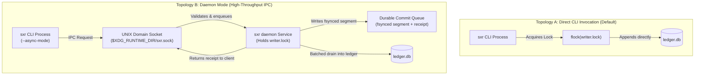

# Runtime Architecture

The runtime architecture of SXR supports two operational topologies: **Direct CLI Invocations** and the **Long-Running Daemon Service**. Both topologies share the same underlying storage engine, locking contracts, and serialization guarantees.

---

## 1. Execution Topologies

---

## 2. Concurrency Control: The Writer Lock

Every modification to a repository's ledger requires acquiring an advisory file lock:
- **Lock Path**: `<repo_dir>/writer.lock` (located at `$XDG_DATA_HOME/sxr/repos/<repo_id>/writer.lock`).
- **Mechanism**: Advisory kernel file locks (`flock(LOCK_EX)` on Unix).
- **Lock Timeout**: 30 seconds blocking wait (`sxr_ledger::writer_lock::WriterLock::acquire`).
- **Single-Writer Invariant**: Only one process (either a CLI invocation or the daemon) can append to `ledger.db` at any given millisecond. Multiple concurrent readers are supported via SQLite WAL mode.

---

## 3. The Daemon Protocol & Durability Parity

When running automated test suites or streaming high-frequency verifier events, acquiring the writer lock repeatedly introduces latency. SXR provides an optional daemon (`sxr daemon`) to batch commits.

### Protocol Sequence
1. **Client Submission**: A CLI command (e.g. `sxr ingest --async-mode`) connects to the UNIX socket at `$XDG_RUNTIME_DIR/sxr.sock`.
2. **Pre-Validation**: The daemon parses the JSON request, verifies the record kind, and validates the CEP envelope.
3. **Queue Enqueue**: The daemon writes the request to a segment file under `$XDG_STATE_HOME/sxr/daemon-queue/<repo_id>/<ulid>.segment` and calls `fsync()`.
4. **Receipt Emission**: Only after the segment is fsynced to disk, the daemon writes an acknowledgment receipt (`<ulid>.receipt`) containing the `idempotency_key` and returns exit code `0` to the client.
5. **Batch Commitment**: The daemon drains segments from the queue in batches and commits them to `ledger.db` under the held writer lock.
6. **Graceful Fallback**: If the daemon socket is unreachable, `sxr ingest --async-mode` transparently falls back to a direct, synchronous commit (`"daemon": false`).

### Durability Parity (AC-DAEMON-001)
The daemon is purely a performance convenience; it **never changes ledger semantics**.
- A sequence of lifecycle events committed directly produces byte-identical ledger entries and byte-identical projection exports as the same sequence submitted via the daemon.
- This parity is verified by [`proof/slice6.sh`](file:///home/sprime01/projects/sxr/proof/slice6.sh).

---

## 4. Crash Recovery & Resilience

### Kill -9 after Receipt
If the daemon process or host is abruptly killed (`SIGKILL`) immediately after the client receives an enqueue receipt:
- The segment file remains intact on disk in the queue directory.
- Running `sxr queue recover` scans the directory, validates segment hashes, and drains pending segments into the ledger.
- If a segment was already committed before the crash, duplicate replay is safely neutralized by the unique `idempotency_key` constraint on the ledger table.

### Spooling under Contention
When a client invokes `sxr ingest --spool`:
- If lock contention or daemon unavailability prevents immediate processing, the raw request is written to `$XDG_STATE_HOME/sxr/spool/<repo_id>/` and the CLI exits with code **75 (EX_TEMPFAIL)**.
- Any subsequent call to `sxr evidence create` on that run is fail-closed blocked (exit 3) until `sxr spool drain` successfully validates and commits the spooled observations.

---

## 5. Source Trail

- [`sxr-cli/src/daemon.rs`](file:///home/sprime01/projects/sxr/sxr-cli/src/daemon.rs) — Daemon listener, socket IPC, batch drain loop.
- [`sxr-cli/src/durability.rs`](file:///home/sprime01/projects/sxr/sxr-cli/src/durability.rs) — Durable queue and spool scanning.
- [`sxr-ledger/src/writer_lock.rs`](file:///home/sprime01/projects/sxr/sxr-ledger/src/writer_lock.rs) — Advisory `flock` implementation.
- [`sxr-ledger/src/queue.rs`](file:///home/sprime01/projects/sxr/sxr-ledger/src/queue.rs) — Segment serialization, receipt fsync, and scan logic.
- [`proof/slice6.sh`](file:///home/sprime01/projects/sxr/proof/slice6.sh) — Daemon durability parity test harness.
