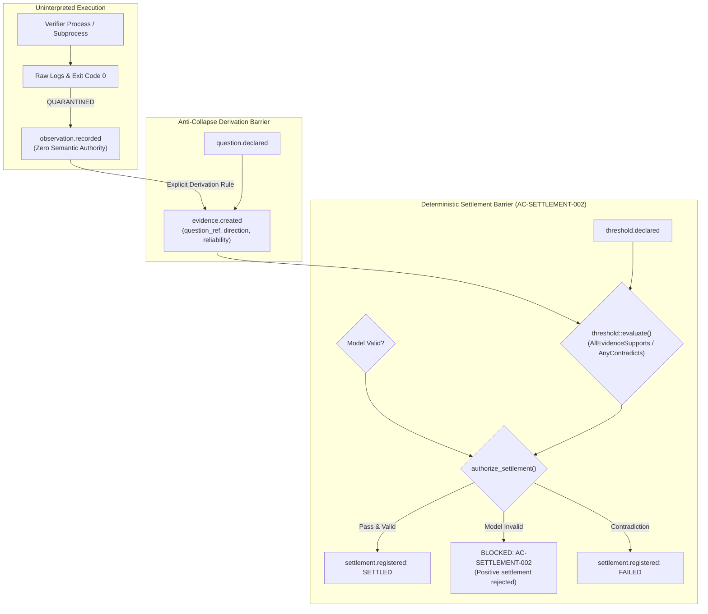

# Explanation: Anti-Collapse Epistemology

This document explains the philosophical and architectural foundations of SXR's **anti-collapse epistemology**, detailing why the runtime enforces strict structural boundaries between raw observations, evidence, representations, and settlements.

---

## 1. The Core Problem: Epistemic Collapse

In modern software development and agentic computing, systems constantly suffer from **epistemic collapse** — the conflation of distinct epistemological categories into a single lossy representation:
- Treating an execution trace as definitive proof that requirements are met.
- Assuming an assertion in source code represents operational reality.
- Declaring a test run "successful" merely because the process did not panic.
- Blaming architectural models when flaky infrastructure fails.

When an autonomous agent operates in an environment plagued by epistemic collapse, it enters destructive feedback loops: hallucinating refactorings, mutating historical evidence, or declaring false victories.

---

## 2. The Seven Collapse Traps (CEP-0008 §53)

SXR is designed to structurally prevent the seven specific collapse shapes identified in the **Common Event Protocol (CEP-0008)**:

> **Interactive Tool**: To step through all 5 epistemic stages, compare $G_{declared}$ and $G_{observed}$ dual graphs, and inspect the 7 Anti-Collapse Axioms, launch the [Epistemic Pipeline, Dual-Graph Projections & Anti-Collapse Workbench](../explainers/epistemic-pipeline-workbench.html).

### 1. Data-as-Evidence Collapse
- **The Trap**: Assuming raw telemetry (logs, exit codes, benchmark numbers) inherently constitutes evidence.
- **The Reality**: Data is neutral observation. It only becomes *evidence* when tied to a specific proposition, with explicit evaluation of relevance, reliability, and direction (`supports` vs `contradicts`).
- **SXR Implementation**: `sxr-verify` returns `observation.recorded` envelopes containing uninterpreted data. Only `sxr evidence create` can produce an `evidence.created` record, requiring explicit question and claim references.

### 2. Representation-as-Reality Collapse
- **The Trap**: Confusing a specification, model, or code AST with the operational behavior of the system.
- **The Reality**: Models are representations of intent. If a model fails to parse or compile, the system does not "exist in an unknown state" — the representation failed.
- **SXR Implementation**: When DomainForge fails to construct a semantic model, SXR emits a `SemanticContext::ValidationFailed` carrying an explicit `OmissionRecord`. It refuses to synthesize placeholder hashes or pretend reality conforms to the invalid text.

### 3. Action-as-Transformation Collapse
- **The Trap**: Assuming that because an action was executed (e.g. running a test, executing a script), state was successfully transformed.
- **The Reality**: Actions are attempted operations; transformations are verified, evidenced state changes.
- **SXR Implementation**: `plan.created` defines an intended action; `observation.recorded` records the attempt; only `settlement.registered` confirms that the transformation achieved verified settlement.

### 4. Completion-as-Settlement Collapse
- **The Trap**: Conflating process termination (exit code 0) with satisfaction of verification criteria.
- **The Reality**: A test process returning 0 may have executed zero tests, filtered out the critical assertion, or tested the wrong property.
- **SXR Implementation**: `run.finished` records that execution terminated. Settlement requires evaluating committed evidence against a pre-declared `ThresholdSpec` via pure algebra (`threshold::evaluate`).

### 5. Authority-as-Capability Collapse
- **The Trap**: Assuming that because a component has the capability to run a tool, its output is authoritative.
- **The Reality**: Capability is computational; authority is governed and cryptographically proven.
- **SXR Implementation**: Subcomponents declare capabilities; only events signed, validated, and appended to the hash-chained ledger possess authority. In the `ablation` harness, live executions are blocked until sealed by an immutable authority artifact.

### 6. Possibility-as-Affordance Collapse
- **The Trap**: Treating an unverified hypothesis or speculative fix as an available actionable path.
- **The Reality**: Speculative ideas are candidate hypotheses, not proven affordances.
- **SXR Implementation**: In the diagnostic loop, candidate failure loci are recorded as `diagnostic.hypothesis`. SXR forbids raising a repair proposal on a hypothesis until it has been formally settled with discriminating evidence.

### 7. Signature-as-Truth Collapse
- **The Trap**: Assuming that because an artifact is cryptographically signed or hashed, its semantic assertions are factually true.
- **The Reality**: Cryptography proves provenance, immutability, and tamper-detection; it does not prove semantic correctness.
- **SXR Implementation**: SXR uses cryptographic hash chains to prove ledger immutability, but evaluates semantic validity through explicit verification thresholds and diagnostic settlement conditions.

---

## 3. Verified Rationale vs Inferred Design

| Architectural Decision | Status | Evidence in Repository |
| :--- | :--- | :--- |
| **Separation of Observation from Evidence** | **Verified Fact** | `sxr-verify` returns observations; `sxr-cli::commands::evidence_create` derives evidence. |
| **AC-SETTLEMENT-002 Invariant** | **Verified Fact** | `sxr-core/src/threshold.rs:authorize_settlement` explicitly rejects positive settlement on invalid models. |
| **Closed 26-Record Vocabulary** | **Verified Fact** | `sxr-core/src/record_kinds.csv` compiled via `build.rs` into static enum. |
| **Asymmetric Diagnostic Friction** | **Verified Fact** | `sxr-cli/src/commands.rs:diagnostic_propose` checks `cheap_loci_excluded`. |
| **Choice of SQLite STRICT over Flat JSONL** | **Strong Inference** | Flat files provide append durability but require costly in-memory indexing; SQLite provides strict typing, WAL concurrency, and indexed queries in a single file. |

---

## 4. Consequences and Trade-Offs
- **Pros**: Completely eliminates silent failure masking, prevents agent hallucination loops, guarantees forensic auditability, and provides cryptographically verifiable proof of correctness.
- **Trade-Offs**: Requires explicit, multi-step ceremonies (declare question $\to$ declare threshold $\to$ begin run $\to$ create plan $\to$ verify $\to$ derive evidence $\to$ register settlement) rather than a single ad-hoc command. SXR prioritizes technical truth over developer shorthand.

---

## 5. Source Trail
- [`schemas/cep-semantic-envelope.mapping.md`](file:///home/sprime01/projects/sxr/schemas/cep-semantic-envelope.mapping.md) — Mapping of CEP-0008 distinctions and §53 collapse shapes.
- [`sxr-core/src/threshold.rs`](file:///home/sprime01/projects/sxr/sxr-core/src/threshold.rs) — Core settlement authorization logic.
- [`sxr-core/src/envelope.rs`](file:///home/sprime01/projects/sxr/sxr-core/src/envelope.rs) — Envelope construction enforcing entity sections and boundary rules.
