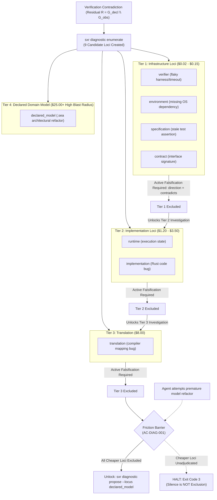

# Explanation: Asymmetric Diagnostic Friction

This document explains the rationale behind **asymmetric diagnostic friction** in SXR's Slice 5 failure attribution loop, detailing why autonomous agents are prohibited from raising model-level repair proposals until cheap infrastructure loci have been evidence-excluded.

---

## 1. The Autonomous Agent Failure Pathology

Empirical observations of autonomous coding agents reveal a consistent failure mode:
1. An agent executes a test suite.
2. A test fails or flakes (due to a missing port, network timeout, or incorrect test harness assertion).
3. The agent reads the failure message and **assumes its high-level domain model or architecture is broken**.
4. The agent rewrites working business models, introduces regressions, and enters an escalating cycle of unnecessary refactorings.

In engineering economics, **modifying the high-level domain model is the most expensive possible repair**:
- It invalidates downstream code, documentation, client contracts, and database migrations.
- Conversely, fixing a flaky verifier, setting an environment variable, or correcting an invalid test specification costs very little.

---

## 2. The Principle of Asymmetric Friction

To halt this pathology, SXR enforces **Asymmetric Diagnostic Friction (AC-DIAG-001)** at the protocol level:
> **Rule**: An agent is mathematically forbidden from proposing changes to the high-level domain model (`declared_model`) while any cheaper failure locus remains unadjudicated.

> **Interactive Tool**: To step through live failure scenarios, observe exit code 3 blocks, and test how active falsification lowers the friction barrier, launch the [Asymmetric Diagnostic Friction & 9-Locus Attribution Simulator](../explainers/diagnostic-friction-simulator.html).

---

## 3. The 9 Candidate Failure Loci Ranked by Cost

| Failure Locus | Cost Tier | Remediation Action |
| :--- | :--- | :--- |
| **`verifier`** | Tier 1 (Lowest) | Fix flaky test assertion, update mock, fix test runner. |
| **`environment`** | Tier 1 (Lowest) | Install missing system package, configure environment variable. |
| **`specification`** | Tier 1 (Lowest) | Correct invalid test inputs or expectation values. |
| **`contract`** | Tier 1 (Lowest) | Reconcile interface definitions between components. |
| **`runtime`** | Tier 2 (Medium) | Fix execution harness or process spawner. |
| **`implementation`**| Tier 2 (Medium) | Fix code implementation without changing the model. |
| **`translation`** | Tier 3 (High) | Fix code generator or compiler mapping. |
| **`declared_model`**| **Tier 4 (Highest)**| **Refactor high-level `.sea` architectural domain model.** |
| **`ambiguity`** | N/A | Gather more discriminating evidence. |

---

## 4. Silence is Not Exclusion

A common flaw in automated diagnosis is "assuming innocence" — assuming that because nobody proved the verifier was broken, the verifier must be fine.

SXR rejects this:
- **Silence is not exclusion**: A candidate locus is NOT excluded simply because no evidence was submitted against it.
- **Active Falsification Required**: To exclude the `verifier` locus, the agent or operator must submit explicit evidence with `direction = "contradicts"` targeting the `verifier` hypothesis.
- Only when all cheaper loci possess explicit falsification evidence does `sxr diagnostic propose --locus declared_model` succeed.

---

## 5. The 4 Conditions for Diagnostic Settlement (§12.5a)

Under `sxr diagnostic settle`:
1. **Discriminating Evidence**: Direct evidence supporting the winning hypothesis.
2. **Alternative Exclusion**: All competing hypotheses are falsified with contradicting evidence.
3. **Threshold Satisfaction**: The supporting evidence satisfies the question's threshold.
4. **No Unadjudicated Contradictions**: Zero unresolved contradictory evidence.

If an agent attempts to settle a hypothesis prematurely or propose a model refactor without excluding the verifier, SXR exits with code **3**, halting the agent in its tracks.

---

## 6. Source Trail

- [`sxr-cli/src/commands.rs:diagnostic_propose`](file:///home/sprime01/projects/sxr/sxr-cli/src/commands.rs) — Asymmetric friction enforcement (AC-DIAG-001).
- [`sxr-cli/src/commands.rs:diagnostic_settle`](file:///home/sprime01/projects/sxr/sxr-cli/src/commands.rs) — Four conditions verification.
- [`proof/slice5.sh`](file:///home/sprime01/projects/sxr/proof/slice5.sh) — Slice 5 Gate 5 proof script verifying refusal of model-locus proposals under flaky verifiers.
