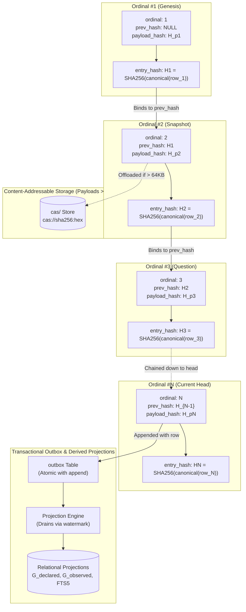

# Explanation: Cryptographic Append-Only Ledger

This document explains why SXR implements an append-only, SHA-256 hash-chained ledger on top of SQLite, detailing the trade-offs between flat files, standard relational databases, and blockchain-like data structures.

---

## 1. The Design Challenge

An audit runtime for autonomous systems must satisfy competing demands:
1. **Immutability & Tamper-Evidence**: If an attacker, rogue script, or buggy agent attempts to rewrite history, the tampering must be mathematically detectable.
2. **Crash Resilience**: Sudden power loss or process kill must never corrupt committed records.
3. **Query Performance**: The system must support indexed relational queries, graph traversals, and full-text search without scanning gigabytes of flat files on every query.
4. **Zero External Infrastructure**: Must run locally without requiring a dedicated server process (e.g. Postgres, Cassandra, or Tendermint).

---

## 2. Evaluation of Alternatives

| Storage Strategy | Tamper Evidence | Crash Resilience | Local Footprint | Query Speed | Verdict |
| :--- | :--- | :--- | :--- | :--- | :--- |
| **Flat JSONL Files** | Poor (files can be edited in place) | Moderate (fsync required per line) | Low | Terrible ($O(N)$ scan per query) | **Rejected**: Querying graph relationships requires reparsing entire file history. |
| **Standard Mutable RDBMS** | None (`UPDATE`/`DELETE` mutate state) | High (ACID WAL) | Medium (Postgres/MySQL) | Fast | **Rejected**: Lacks cryptographic proof of immutability; external daemon required. |
| **Full Blockchain Engine** | High (Merkle trees, consensus) | High | Massive (peers, consensus overhead) | Slow | **Rejected**: SXR runs in single-node/local-developer contexts; consensus overhead is unnecessary. |
| **Append-Only SQLite + Hash Chains** | **Cryptographic (Dense SHA-256 chain)** | **High (SQLite STRICT + WAL + fsync)** | **Minimal (single file `ledger.db`)** | **Fast (indexed ordinals + CQRS outbox)** | **Selected** |

---

## 3. The Hash Chain Mathematics

In `sxr-ledger`, every entry in the `ledger` table binds its predecessor in a dense, gapless sequence:

> **Interactive Tool**: To experiment with live cryptographic chain verification and observe how tampering with any payload breaks downstream links, launch the [Cryptographic Ledger & Settlement Explorer](../explainers/ledger-and-settlement-explorer.html).

### Hash Computation Formula
The `entry_hash` is computed over a canonical JSON object:

$$\text{entry\_hash} = \text{SHA256}(\text{canonical\_json}(\{ \text{ledger\_id}, \text{append\_ordinal}, \text{entry\_ulid}, \text{record\_kind}, \text{idempotency\_key}, \text{subject\_refs}, \text{canonicalization}, \text{hash\_algorithm}, \text{payload\_hash}, \text{previous\_entry\_hash}, \text{committed\_at}, \text{writer\_identity\_ref} \}))$$

Where:
- `payload_hash = SHA256(canonical_json(payload))`
- `payload` is the full CEP-0008 JSON envelope.
- Excluding `payload` from the primary hash struct and binding it via `payload_hash` allows streaming verification without reparsing large JSON trees into memory.

---

## 4. Why Canonical JSON?

JSON serialization is inherently nondeterministic across platforms and programming languages (key ordering differences, floating-point formatting, whitespace variance). 

To ensure that `entry_hash` is byte-exact across all environments:
- SXR implements `sxr_core::canonical_json::canonical_json`.
- Object keys are strictly sorted lexicographically.
- Whitespace between separators is eliminated.
- String escaping is standardized.
- This ensures that an entry hashed in Rust, Python, or Go yields the identical 64-character hex string.

---

## 5. Ledger Generations & Destructive Recovery

In real-world operations, hard drives suffer bad sectors, or operators may mistakenly corrupt a database file:
- SXR introduces the concept of **Ledger Generations** (`sxr-ledger/src/generation.rs`).
- The `ledger_id` column identifies the active generation.
- If unrecoverable corruption occurs, SXR never edits the corrupted ledger in place. Instead, it moves the damaged generation to quarantine, mints a new `ledger_id`, and appends a `ledger.destructive_recovery` record in the new generation documenting the discarded range and quarantine report.
- The historical record remains intact, and the break in continuity is explicitly recorded.

---

## 6. Source Trail

- [`sxr-core/src/canonical_json.rs`](file:///home/sprime01/projects/sxr/sxr-core/src/canonical_json.rs) — Canonical JSON serializer.
- [`sxr-core/src/chain.rs`](file:///home/sprime01/projects/sxr/sxr-core/src/chain.rs) — Chain hashing and verification logic.
- [`sxr-ledger/src/schema.rs`](file:///home/sprime01/projects/sxr/sxr-ledger/src/schema.rs) — Frozen `ledger` table DDL.
- [`sxr-ledger/src/ledger.rs`](file:///home/sprime01/projects/sxr/sxr-ledger/src/ledger.rs) — SQLite append implementation.
- [`sxr-ledger/src/generation.rs`](file:///home/sprime01/projects/sxr/sxr-ledger/src/generation.rs) — Generation tracking and destructive recovery.
