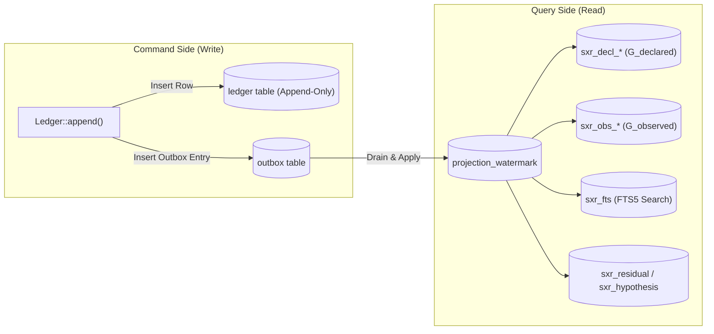

# Explanation: CQRS Projections & The Transactional Outbox

This document explains why SXR decouples its write model (the immutable ledger) from its read models ($G_{declared}$, $G_{observed}$, FTS search) using Command Query Responsibility Segregation (CQRS) and the Transactional Outbox pattern.

---

## 1. The Conflict Between Append-Only Logs and Rich Queries

An audit ledger requires a strictly append-only write path:
- Writes must be atomic, fast, and protected by an exclusive file lock.
- Altering existing rows or performing complex multi-table joins during an append slows down ingestion and risks deadlocks.

Conversely, queries from developer agents require rich, indexed views:
- "What concepts does this class declare?" (Requires $G_{declared}$ graph traversal).
- "What evidence supports the relationship between Warehouse and Factory?" (Requires $G_{observed}$ edge lookup).
- "Search declarations matching 'order status'" (Requires full-text search).

Executing these queries directly against raw JSON payloads in the `ledger` table would require parsing JSON strings across thousands of rows on every query ($O(N)$ overhead).

---

## 2. CQRS in a Single SQLite Database

SXR resolves this by adopting **CQRS (Command Query Responsibility Segregation)** within `ledger.db`:



### The Transactional Outbox Pattern
When a row is appended:
1. SXR inserts the row into `ledger`.
2. Within the **same SQLite transaction**, SXR inserts a record into `outbox` naming the required projectors:
   ```sql
   INSERT INTO outbox (ledger_id, append_ordinal, projections) VALUES (?, ?, '["projections"]');
   ```
3. If the process crashes mid-append, SQLite atomicity guarantees that either both rows exist or neither does.
4. Asynchronous projectors drain the outbox, update their watermarks in `projection_watermark`, and delete processed outbox entries.

---

## 3. Epistemic Status of Projections: Zero Authoritative Truth

A critical invariant of SXR is that **projection tables own zero authoritative truth**:
- If a projection table is corrupted, accidentally altered, or suffers schema drift, **no scientific or historical evidence is lost**.
- An operator can run:
  ```bash
  sxr projections rebuild --repo <id> --all
  ```
- This drops all projection tables (`sxr_decl_*`, `sxr_obs_*`, `sxr_fts*`), reapplies the schema DDL, and replays every ledger row from ordinal 1 to the head in strict predecessor order.

### Rebuild Determinism (AC-REPLAY-002)
Because projections are pure deterministic folds over the ledger:
- Rebuilding projections from scratch produces an export that is **byte-for-byte identical** to the export taken before the rebuild.
- Verified in `proof/slice3.sh` and `proof/slice4.sh`.

---

## 4. Contentless FTS5 External Search

SQLite's FTS5 engine typically stores a duplicate copy of indexed text inside internal shadow tables (`*_content`). This would duplicate large JSON envelope payloads on disk.

SXR avoids this duplication by using **contentless external content**:
```sql
CREATE TABLE sxr_fts_content (
    rowid INTEGER PRIMARY KEY,
    subject_key TEXT NOT NULL,
    kind TEXT NOT NULL,
    title TEXT NOT NULL,
    body TEXT NOT NULL
) STRICT;

CREATE VIRTUAL TABLE sxr_fts USING fts5(
    subject_key, kind, title, body,
    content = 'sxr_fts_content',
    content_rowid = 'rowid',
    tokenize = 'porter unicode61 remove_diacritics 2'
);
```
- The virtual table `sxr_fts` references `sxr_fts_content`.
- When search results are returned, the row ID maps directly back to the source record, ensuring every search hit points to an immutable ledger record (§12.6).

---

## 5. Source Trail

- [`sxr-ledger/src/outbox.rs`](file:///home/sprime01/projects/sxr/sxr-ledger/src/outbox.rs) — Outbox insertion and draining.
- [`sxr-ledger/src/schema.rs`](file:///home/sprime01/projects/sxr/sxr-ledger/src/schema.rs) — `OUTBOX_DDL` and `projection_watermark` table definitions.
- [`sxr-cli/src/projections.rs`](file:///home/sprime01/projects/sxr/sxr-cli/src/projections.rs) — Projection DDL, row application, rebuild logic, and FTS5 configuration.
- [`proof/slice3.sh`](file:///home/sprime01/projects/sxr/proof/slice3.sh) — Proof of rebuild determinism and FTS5 queries.
