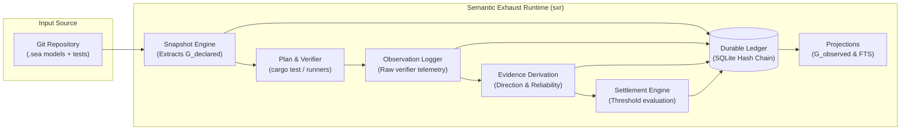

# Semantic Exhaust Runtime (SXR)

Welcome to the technical knowledge system for **SXR (Semantic Exhaust Runtime)**, the core observation, evidence, and settlement engine of **RealityTrace**.

---

## 1. What This Project Is

SXR is an append-only, cryptographic audit and settlement runtime designed for software engineering verification and autonomous developer agent telemetry. It records what actually happened during software development and testing, verifies event streams against strict semantic envelope contracts, maintains tamper-evident hash-chained ledgers, and deterministically evaluates whether verification obligations have been settled.

---

## 2. What Problem It Solves

Modern agentic engineering tools and automated CI pipelines suffer from severe **epistemological collapse**:
- **Tests treated as truth**: When a test passes, an agent assumes the feature works; when a flaky test fails, the agent assumes the code is wrong.
- **Silent history loss**: Test retries overwrite prior failures, destroying evidence of flakiness or environmental corruption.
- **Premature model blame**: When automated verification fails, developer agents typically assume their code or architecture model is broken and hallucinate refactorings, even when the real defect is an unconfigured test environment, network timeout, or faulty test harness.
- **Unearned settlement**: Verification is declared "successful" simply because a process exited with code `0`, without proving that the observations satisfied pre-registered acceptance criteria.

SXR provides an immutable, verifiable substrate that enforces **anti-collapse boundaries**:
- Raw execution output is preserved as an **Observation**, not proof.
- Observations are transformed into **Evidence** only through explicit, pre-declared derivation rules.
- **Settlement** requires evaluating strictly earlier evidence against a pre-registered **Threshold**.
- A 9-locus **Diagnostic Attribution Loop** prevents agents from modifying code or domain models until infrastructure, verifier, and environmental failure loci have been systematically excluded with evidence.

---

## 3. The System in One Picture

---

## 4. Interactive Cognitive Explainers

Rather than mentally simulating complex asynchronous state transitions, explore the runtime mechanisms directly through self-contained, offline-first interactive applications:

- **[Cognitive Representation Portal](./explainers/index.html)**: Central navigation dashboard connecting all visual models, reader personas, and implementation source trails.
- **[Asymmetric Diagnostic Friction & 9-Locus Attribution Simulator](./explainers/diagnostic-friction-simulator.html)**: Interactively step through failure scenarios, observe exit code 3 refusal of premature model changes, and test how active falsification lowers the friction barrier (`AC-DIAG-001`).
- **[Cryptographic Append-Only Ledger & Settlement Explorer](./explainers/ledger-and-settlement-explorer.html)**: Inspect the dense SHA-256 hash chain in SQLite, test real-time tamper detection, and evaluate threshold algebra over live evidence (`AC-LEDGER-001`, `AC-SETTLEMENT-002`).
- **[Epistemic Pipeline, Dual-Graph Projections & Anti-Collapse Workbench](./explainers/epistemic-pipeline-workbench.html)**: Step through the 5 epistemic stages, compare $G_{declared}$ side-by-side with $G_{observed}$, and examine the 7 CEP-0008 anti-collapse axioms.

---

## 5. The 10 Concepts You Need First

1. **Semantic Snapshot (`semantic.snapshot`)**: An immutable record of a repository's declared semantic model (`.sea` files) at a specific point in time, extracted via DomainForge.
2. **Question (`question.declared`)**: A formal inquiry regarding the codebase (e.g. "Does concept X satisfy invariant Y?").
3. **Threshold (`threshold.declared`)**: A pre-registered algebraic rule (e.g. `AllEvidenceSupports`, `AnyEvidenceContradicts`) defining exactly what evidence is required to settle a Question.
4. **Run (`run.started` / `run.finished`)**: A bounded execution attempt binding a snapshot, question, and threshold together.
5. **Plan (`plan.created`)**: An executable verification strategy specifying the verifier runner (e.g. `cargo-test`) and target declaration.
6. **Observation (`observation.recorded`)**: Raw, uninterpreted execution telemetry emitted by a verifier process.
7. **Evidence (`evidence.created`)**: An interpreted observation evaluated against a target claim with explicit `relevance`, `reliability`, and `direction` (`supports` vs `contradicts`).
8. **Settlement (`settlement.registered`)**: An immutable verdict (`settled`, `partially_settled`, `failed`, `settled_with_debt`) registered when evidence satisfies or fails a threshold.
9. **Ledger (`ledger.db`)**: An append-only SQLite database storing cryptographically chained records ($h_n = \text{SHA256}(\text{canonical}(\text{row}_n))$).
10. **Projections**: Read-optimized derived relational tables ($G_{declared}$, $G_{observed}$, FTS5 search) rebuilt deterministically from the ledger.

---

## 6. A Representative Journey

Here is how a single verification lifecycle unfolds from start to finish:

1. **Enrollment**: You enroll a Git repository using `sxr repo enroll <path>`. SXR mints a fresh, immutable ULID identity and records discovery evidence. SXR **never writes inside your Git repository**.
2. **Snapshot**: You run `sxr snapshot create --repo <id>`. SXR calls the DomainForge adapter, parses `.sea` model files, computes the semantic closure hash, and records a `semantic.snapshot` envelope to the ledger.
3. **Question & Threshold**: You declare a Question (e.g., verifying a domain concept) and a Threshold (`AllEvidenceSupports`, requiring medium reliability).
4. **Run & Plan**: You begin a run (`sxr run begin`), then create a verification plan (`sxr plan create --verifier cargo-test`).
5. **Verification**: You execute `sxr verify run --run <id>`. SXR spawns `cargo test`, captures streaming JSON output, and commits an `observation.recorded` envelope.
6. **Evidence Derivation**: You run `sxr evidence create --derive`. SXR links the observation to the target question and threshold, computing evidence direction (`supports`).
7. **Settlement**: You run `sxr settlement register`. SXR deterministically evaluates the threshold over the committed evidence and registers `settled`.
8. **Rebuild & Audit**: Projections are updated in the background. You run `sxr ledger verify` to cryptographically prove that the hash chain is dense, intact, and untampered.

---

## 7. Where to Go Next

Choose the path that fits your current goal:

| Your Goal | Recommended Starting Page |
| :--- | :--- |
| **I want an interactive visual explanation** | [Cognitive Representation Portal](./explainers/index.html) |
| **I want a hands-on tutorial** | [Quickstart Tutorial](./tutorials/quickstart.md) |
| **I want to understand the conceptual philosophy** | [Mental Model](./mental-model.md) & [Anti-Collapse Epistemology](./explanation/anti-collapse-epistemology.md) |
| **I want to inspect the architectural topology** | [Architecture Specification](../architecture.md) & [Logical Architecture](./architecture/logical.md) |
| **I want to understand a specific crate or subsystem** | [Subsystems Directory](./subsystems/sxr-core.md) |
| **I need to run, manage, or debug the system** | [How-To Guides Index](./how-to/enroll-and-configure.md) & [CLI Reference](./reference/cli.md) |
| **I need to install a precompiled binary** | [Install Native Binaries](./how-to/install-native-binaries.md) |
| **I want to look up schemas, record kinds, or exit codes** | [Technical Reference](./reference/schemas.md) |
| **I need to find the implementation of a concept** | [Source Traceability Map](../source-map.md) |
| **I want to see the full documentation map** | [Documentation Map](../documentation-map.md) |
