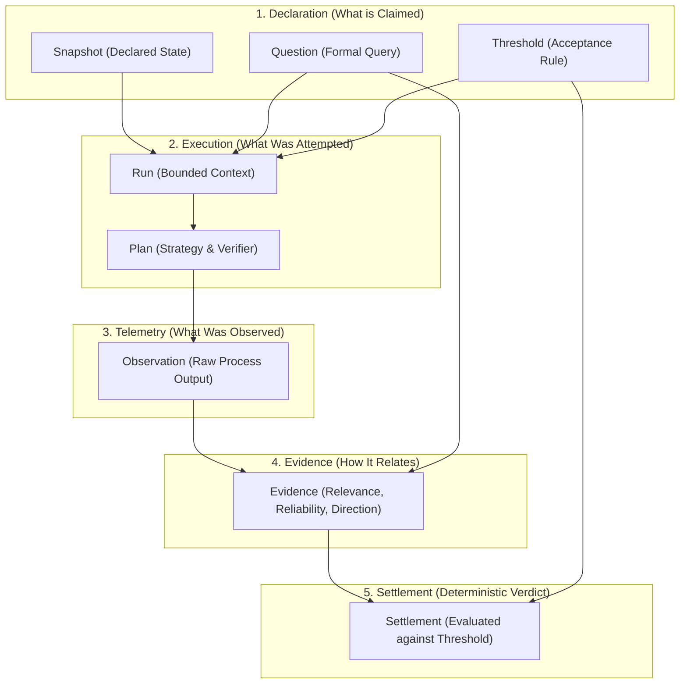
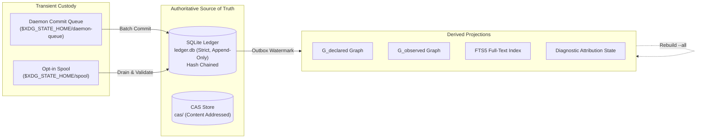

# SXR Mental Model & Epistemic Pipeline

To understand SXR, you must not view it as a test runner or build tool. SXR is an **epistemological audit engine** that formalizes how assertions become proven facts.

---

## 1. The Epistemological Problem

In standard development workflows, verification is treated as an informal shortcut:
1. An engineer or LLM writes code and test assertions.
2. The test runner executes and outputs exit code `0`.
3. The system claims: *"The feature is verified."*

This shortcut collapses multiple distinct epistemic states into one. When a failure occurs:
- Is the model/architecture wrong?
- Is the implementation code wrong?
- Is the test assertion flawed?
- Did the test harness flake?
- Is the environment missing a dependency?

Because standard tools do not separate these concerns, automated agents routinely misdiagnose failures. They refactor working domain models when the true issue was an environmental flake, or claim success when a test passed without testing the intended invariant.

---

## 2. The Five Epistemic Stages

SXR replaces the shortcut with a rigid, 5-stage pipeline:

### Stage 1: Declaration (The Expected World)
Before running any code, the expected world must be declared and committed:
- **Semantic Snapshot**: Extracted from declarative specifications (`.sea` files) via DomainForge. It forms $G_{declared}$, the graph of declared concepts, roles, resources, and flows.
- **Question**: Declares the hypothesis under investigation (e.g. `is_true` for concept `order_processing`).
- **Threshold**: Declares the criteria for settlement (e.g. `AllEvidenceSupports`, requiring medium reliability).

### Stage 2: Execution (The Attempt)
- A **Run** binds a snapshot, question, and threshold together with execution metadata (git commit, working tree dirty status).
- A **Plan** defines an executable strategy, naming the specific verifier tool (e.g., `cargo-test`) and the target declaration.

### Stage 3: Telemetry (The Raw Observation)
The verifier runs in an isolated subprocess. Its stdout, stderr, exit code, and test counts are captured as an **Observation**.
> **Rule**: An observation possesses zero semantic authority. It does not state whether a feature works; it only states what the subprocess printed.

### Stage 4: Evidence (The Qualified Relation)
An observation is promoted to **Evidence** only through an explicit derivation step. Evidence must declare:
- `question_ref`: Which question it addresses.
- `target_ref`: Which declaration or relation claim it targets.
- `relevance`: High, medium, or low.
- `reliability`: High, medium, or low.
- `direction`: Does this observation `supports`, `contradicts`, or remain `unknown` relative to the claim?

### Stage 5: Settlement (The Verdict)
Settlement is evaluated purely mathematically by the `sxr-core::threshold::evaluate` function:
- Strictly earlier evidence is evaluated against the pre-registered threshold.
- The outcome is registered as `settled`, `partially_settled`, `failed`, or `settled_with_debt`.
- **Invariant (AC-SETTLEMENT-002)**: If the snapshot's declared model was invalid, positive acceptance (`settled`) is rejected at the protocol boundary.

---

## 3. The 7 Anti-Collapse Axioms

SXR structurally prevents the seven collapse shapes defined in **CEP-0008 §53**:

| Collapse Trap | SXR Structural Prevention |
| :--- | :--- |
| **1. Data as Evidence** | Raw data is confined to `observation.recorded`. `evidence.created` requires explicit direction and question bindings. |
| **2. Representation as Reality** | When `.sea` model parsing fails, SXR emits a validation failure with an explicit `OmissionRecord`, refusing to synthesize placeholder hashes. |
| **3. Action as Transformation** | Executing `verify run` produces an observation of an action; only evidenced changes in state constitute a transformation. |
| **4. Completion as Settlement** | Process exit code `0` produces `run.finished`, never `settlement.registered`. Settlement is a separate transaction evaluated against a threshold. |
| **5. Authority as Capability** | Enrolled repositories and verifiers declare capability; only cryptographically signed and hash-chained records confer authority. |
| **6. Possibility as Affordance** | Hypothetical paths in diagnostic loops are typed as `diagnostic.hypothesis`, never acted upon until settled. |
| **7. Signature as Truth** | Signatures and hashes prove tamper-evidence and authorship, not that the semantics of the payload are true. |

---

## 4. State Ownership and Boundaries

SXR maintains three distinct categories of state:

1. **Transient Custody**:
   - Filesystem queues where uncommitted incoming requests wait before being fsynced or drained.
   - If the system crashes, recovery drains these queues into the ledger without data loss.
2. **Authoritative Ledger**:
   - The append-only `ledger` table in SQLite and the `cas/` blob store.
   - Immutable, dense, gapless hash chains ($h_n = \text{SHA256}(\text{row}_n)$).
   - Once committed, a ledger row is never modified or deleted.
3. **Derived Projections**:
   - Relational tables ($G_{declared}$, $G_{observed}$, diagnostic tables, FTS5).
   - Possess zero authoritative truth; they are pure read-model projections.
   - Can be completely deleted and rebuilt from the ledger at any time (`sxr projections rebuild --all`).

---

## 5. Source Trail

- [`sxr-core/src/types.rs`](file:///home/sprime01/projects/sxr/sxr-core/src/types.rs) — Domain models: `SemanticContext`, `Evidence`, `SettlementStatus`, `SnapshotRow`.
- [`sxr-core/src/threshold.rs`](file:///home/sprime01/projects/sxr/sxr-core/src/threshold.rs) — Threshold algebra and AC-SETTLEMENT-002 invariant.
- [`sxr-core/src/envelope.rs`](file:///home/sprime01/projects/sxr/sxr-core/src/envelope.rs) — CEP-0008 envelope construction, boundary vocabulary, and entity sections.
- [`schemas/cep-semantic-envelope.mapping.md`](file:///home/sprime01/projects/sxr/schemas/cep-semantic-envelope.mapping.md) — Anti-collapse collapse shapes mapping.
