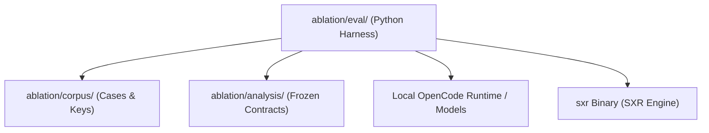

# Subsystem Guide: `ablation`

The `ablation` subsystem is the empirical evaluation and scientific audit harness of SXR. It conducts formal ablation studies testing hypothesis attribution, anti-collapse epistemology, and model drift under strict governance rules.

---

## 1. Purpose
To empirically demonstrate and audit SXR's scientific guarantees across multiple revisions of language models and autonomous agents, enforcing raw-before-score semantics, immutable historical lineage, and outcome-blind replacement.

---

## 2. Responsibilities
- Manage empirical evaluation corpora (`ablation/corpus/`).
- Define and execute evidence revisions: **ER001** (initial pilot) and **ER002** (governed diagnostic acquisition).
- Maintain frozen execution revisions (**exec001** through **exec005** / **exec006**) with cryptographic fingerprint bindings.
- Enforce the 16-shard / 4-worker scientific execution topology.
- Require synthetic preflight qualification (e.g. 20/20 synthetic calls delivered with zero ambiguity) before full execution.
- Maintain immutable authority records sealing candidate git commits, qualification reports, and runtime contracts.
- Enforce raw-before-score and outcome-blind replacement rules (a run is replaced only based on pre-registered governance criteria, never because its scientific result was unfavorable).

---

## 3. Non-Responsibilities
- **Runtime CLI Operations**: Does not ship as part of the production `sxr` binary.
- **In-Place Mutation**: Historical run evidence is strictly immutable. Failed runs are never deleted or modified in place.

---

## 4. Position in the System
The `ablation` harness sits alongside the Rust crates, using Python (`uv` / `pytest`) to orchestrate multi-shard scientific experiments against SXR repositories and external model endpoints.

---

## 5. Core Abstractions

| Symbol / Artifact | Location | Description |
| :--- | :--- | :--- |
| `evidence-revision-002-contract.json` | [`ablation/analysis/post-audit-v2/`](file:///home/sprime01/projects/sxr/ablation/analysis/post-audit-v2/) | Scientific contract defining the ER002 experiment, hypotheses, and acceptance criteria. |
| `evidence_revision_002_exec005.py` | [`ablation/eval/v2/`](file:///home/sprime01/projects/sxr/ablation/eval/v2/) | Execution coordinator managing qualification, authority sealing, and shard execution. |
| `full-authority-v1` | [`ablation/analysis/post-audit-v2/`](file:///home/sprime01/projects/sxr/ablation/analysis/post-audit-v2/) | Hash-bound immutable authority artifact binding reviewed commit, qualification bytes, and owner intent. |
| `ShardPlan` | [`ablation/eval/matrix.py`](file:///home/sprime01/projects/sxr/ablation/eval/matrix.py) | Partitioning of the 430 evaluation coordinates across 16 shards and 4 workers. |

---

## 6. Internal Operation

### The Authority & Execution Gate
Before any payment-bearing or live model evaluation can occur:
1. **Offline Preflight**: Coordinates, matrix, and shard plans are verified against frozen hashes without network access.
2. **Synthetic Qualification**: Executes 20 synthetic qualification calls against the target runtime adapter. Every call must succeed with zero ambiguity (`20/20 delivered`).
3. **Session Provenance Audit**: Read-only audit inspecting session logs, verifying that routes and agent configurations match and that no tool calls were leaked.
4. **Authority Minting**: `authorize-full` combines qualification report hashes, provenance audit hashes, reviewed candidate git commit hash, and owner intent into an immutable authority JSON artifact.
5. **Shard Execution**: Shard runners verify the sealed authority artifact before constructing the runtime client. Unsealed or unauthorized executions fail closed.

### Outcome-Blind Replacement
In accordance with `AGENTS.md` and SXR governance:
- If a model outputs an unexpected, incomplete, or empty answer, that is recorded as a **scientific outcome**, not an infrastructure failure.
- A run is eligible for replacement **only** if transport ambiguity, server HTTP 500/503 errors, or provider authorization crashes occurred, and only according to pre-registered rules.

---

## 7. State
- `ablation/corpus/`: Ground-truth benchmark cases, questions, and keys.
- `ablation/analysis/post-audit-v2/`: Frozen JSON contracts, qualification audits, and authority records.
- Historical run artifacts: Preserved read-only in evaluation directories.

---

## 8. Lifecycle
- Offline validation via `pytest`.
- Live qualification and authority minting.
- Sharded execution across 16 shards.
- Post-hoc forensic analysis and settlement reporting.

---

## 9. Failure Modes & Diagnostic Codes
- `FROZEN_NOT_AUTHORIZED`: Attempted to run a shard without a sealed authority artifact.
- `QUALIFICATION_FAILED`: Synthetic preflight calls failed or exhibited transport ambiguity.
- `UPSTREAM_MODEL_ID_RETIRED`: The upstream model provider retired the configured model identifier (as recorded in `.agents/plans/exec006-model-drift-successor.md`).

---

## 10. Extension Points
- Create new execution revisions (e.g. `exec006`) binding fresh model endpoints while preserving immutable ER002 scientific design.

---

## 11. Source Trail
- [`ablation/eval/v2/evidence_revision_002_exec005.py`](file:///home/sprime01/projects/sxr/ablation/eval/v2/evidence_revision_002_exec005.py) — Exec005 coordinator.
- [`ablation/analysis/post-audit-v2/`](file:///home/sprime01/projects/sxr/ablation/analysis/post-audit-v2/) — Immutable authority artifacts.
- [`.agents/CURRENT_STATUS.md`](file:///home/sprime01/projects/sxr/.agents/CURRENT_STATUS.md) — Operational tracking of ablation study status.
- [`.agents/plans/exec006-model-drift-successor.md`](file:///home/sprime01/projects/sxr/.agents/plans/exec006-model-drift-successor.md) — Model drift successor plan.
