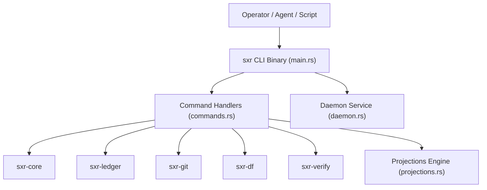

# Subsystem Guide: `sxr-cli`

`sxr-cli` is the command-line interface, orchestration engine, and daemon coordinator of SXR. It processes operator commands, drives the verification lifecycle, synchronizes derived relational projections ($G_{declared}$, $G_{observed}$, FTS5), and manages durable daemon queue recovery.

---

## 1. Purpose
To provide the unified entry point for operators and autonomous agents interacting with SXR, orchestrating lifecycle transitions and maintaining projection read-models while strictly enforcing protocol invariants.

---

## 2. Responsibilities
- Parse command-line arguments and flags via `clap` (`main.rs`).
- Map errors and invariant violations to §15 exit codes (0, 2, 3, 4, 5, 6, 75) (`main.rs:exit_for_error`).
- Maintain repository registries and semantic configuration files under `$XDG_DATA_HOME/sxr` (`state.rs`).
- Orchestrate end-to-end command execution (`commands.rs`).
- Rebuild and export derived relational and graph projections (`projections.rs`).
- Operate the background UNIX domain socket daemon and handle async submissions (`daemon.rs`).
- Scan transient durability states across commit queues and spools (`durability.rs`).
- Provide determinism injection seams for daemon parity testing (`determinism.rs`).

---

## 3. Non-Responsibilities
- **Raw Cryptographic Algorithms**: Delegates hash calculation to `sxr-core::canonical_json` and `sxr-core::chain`.
- **Direct Git/Compiler Logic**: Delegates discovery to `sxr-git` and compilation to `sxr-df`.

---

## 4. Position in the System
`sxr-cli` sits at the top of the workspace dependency tree, consuming all other crates (`sxr-core`, `sxr-ledger`, `sxr-git`, `sxr-df`, `sxr-verify`).

---

## 5. Core Abstractions

| Symbol | Location | Description |
| :--- | :--- | :--- |
| `struct Ctx` | [`src/state.rs`](file:///home/sprime01/projects/sxr/sxr-cli/src/state.rs) | Runtime filesystem context resolving XDG data, state, queue, and socket paths. |
| `enum Command` | [`src/main.rs`](file:///home/sprime01/projects/sxr/sxr-cli/src/main.rs) | Clap command hierarchy representing all 28 CLI subcommands. |
| `struct RepoLedger` | [`src/ledger_io.rs`](file:///home/sprime01/projects/sxr/sxr-cli/src/ledger_io.rs) | Active write session binding an open `Ledger` to an acquired `WriterLock`. |
| `fn apply_row_with_cas` | [`src/projections.rs`](file:///home/sprime01/projects/sxr/sxr-cli/src/projections.rs) | Applies an immutable ledger row to all derived relational projection tables. |
| `struct PendingEntry` | [`src/durability.rs`](file:///home/sprime01/projects/sxr/sxr-cli/src/durability.rs) | In-memory representation of an uncommitted segment or spooled item. |

---

## 6. Internal Operation

### Command Execution Lifecycle
For any command modifying repository state (e.g. `sxr run begin`):
1. Initializes `Ctx::new()` to ensure XDG root directories exist.
2. Acquires the writer flock via `open_repo_ledger(ctx, repo_id)` (timeout: 30s).
3. Reads prior committed state to verify preconditions (e.g., that the referenced snapshot exists).
4. Assembles the schema-valid CEP envelope using `envelopes::build()`.
5. Appends the envelope to `ledger.db` via `append_record()`.
6. Invokes `projections::apply_row_with_cas()` to incrementally update projection tables.
7. Drops the writer lock and prints machine-readable JSON to stdout.

### Semantic Snapshot & Settlement Guards (AC-SETTLEMENT-002)
- **Snapshot Creation**: `sxr snapshot create` compiles the model via `sxr-df`, extracts `model_validation_status`, writes `semantics_version = "v2-independent-validity"` into `sxr_snapshot`, and preserves the real diagnostic list.
- **Settlement Registration**: `sxr settlement register` reads both `model_validation_status` and `semantics_version` for the source snapshot and calls `authorize_settlement`. Positive acceptance (`Settled` / `PartiallySettled`) fails closed (Exit 3) if `semantics_version == "v1-legacy"` (legacy untrusted snapshots) or if `model_validation_status == "invalid"`.
- **Projection Schema Migration**: `sxr_snapshot` includes `semantics_version TEXT NOT NULL DEFAULT 'v1-legacy'`. Migrations in `projections::open` run `ALTER TABLE sxr_snapshot ADD COLUMN semantics_version TEXT NOT NULL DEFAULT 'v1-legacy'` idempotently on existing databases.

### Diagnostic Loop Coordination (Slice 5)
When verifier contradictions are diagnosed:
1. `sxr residual compute`: Analyzes snapshot deltas and computes `residual.computed` records with `attribution_status = "undiagnosed"`.
2. `sxr diagnostic enumerate`: Creates the diagnostic question, threshold, and 9 candidate failure locus hypotheses.
3. `sxr diagnostic settle`: Enforces that all four §12.5a conditions are met before allowing a hypothesis to settle.
4. `sxr diagnostic propose`: Requires that cheap loci (verifier, environment) are evidence-excluded before allowing a `declared_model` repair proposal (AC-DIAG-001).

---

## 7. State
- `$XDG_DATA_HOME/sxr/repos/<repo_id>/`:
  - `registry.json`: Enrollment metadata.
  - `semantic.json`: Namespace configuration.
  - `ledger.db`: SQLite database containing the ledger and projection tables.
  - `writer.lock`: Advisory lock file.
- `$XDG_STATE_HOME/sxr/`:
  - `daemon-queue/`: Queued segment files awaiting batch commit.
  - `spool/`: Spooled entries under contention.

---

## 8. Lifecycle
- Invoked per command execution from the shell.
- When started as `sxr daemon`, runs an infinite listener loop over the UNIX socket until signaled.

---

## 9. Failure Modes & Diagnostic Codes
Mapped in `main.rs:exit_for_error`:
- **Exit 0**: Success.
- **Exit 2**: Command-line usage error, unknown flag, or doctor failure.
- **Exit 3**: Precondition failure, missing record, AC-SETTLEMENT violation, or AC-DIAG violation.
- **Exit 4**: CEP envelope schema validation failure.
- **Exit 5**: Ledger hash chain divergence or cryptographic integrity failure.
- **Exit 6**: Verifier process runner failure.
- **Exit 75**: Temporary failure / request spooled under contention (`EX_TEMPFAIL`).

---

## 10. Extension Points
- **New Subcommands**: Add enum variants to `Command` in `main.rs` and implement handler functions in `commands.rs`.
- **New Projections**: Add table DDL to `PROJECTION_DDL` and row mapping logic to `projections.rs:apply_row_with_cas`.

---

## 11. Source Trail
- [`sxr-cli/src/main.rs`](file:///home/sprime01/projects/sxr/sxr-cli/src/main.rs) — CLI entry point, argument parsing, exit code mapping.
- [`sxr-cli/src/commands.rs`](file:///home/sprime01/projects/sxr/sxr-cli/src/commands.rs) — All subcommand implementation handlers.
- [`sxr-cli/src/projections.rs`](file:///home/sprime01/projects/sxr/sxr-cli/src/projections.rs) — Relational projection engine and DDL.
- [`sxr-cli/src/daemon.rs`](file:///home/sprime01/projects/sxr/sxr-cli/src/daemon.rs) — UNIX socket daemon service.
- [`sxr-cli/src/state.rs`](file:///home/sprime01/projects/sxr/sxr-cli/src/state.rs) — Filesystem context and configuration persistence.
