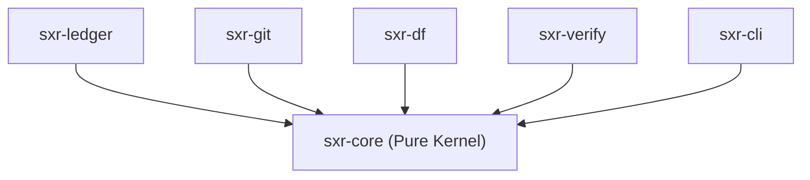

# Subsystem Guide: `sxr-core`

`sxr-core` is the zero-I/O mathematical and epistemological kernel of SXR. It contains core domain types, canonical JSON serialization, CEP-0008 semantic envelope validation, the compiled 26-record-kind registry, threshold evaluation algebra, cryptographic hash chain computation, and inter-system convergence gates.

---

## 1. Purpose
To define the immutable types, schemas, cryptographic formulas, and protocol invariants that govern the Semantic Exhaust Runtime, completely isolated from filesystem, network, or database I/O.

---

## 2. Responsibilities
- Define core identifiers: `RepoIdentity`, `LedgerPosition`, `DeclKey`, and `LedgerRow`.
- Provide canonical JSON serialization and SHA-256 digest computation (`canonical_json.rs`).
- Compile and enforce the 26 closed record kinds from `src/record_kinds.csv` (`build.rs`).
- Validate CEP-0008 semantic envelopes in-memory using embedded JSON schemas (`embedded_schema.rs`, `envelope.rs`).
- Implement deterministic hash chain math and chain verification (`chain.rs`).
- Implement deterministic threshold evaluation and settlement authorization guards (`threshold.rs`).
- Implement the E7 ProofCompleted ingestion gate (`proof_ingest.rs`) and E8 EvidenceRecorded emission gate (`evidence_emit.rs`).
- Provide pure hybrid logical clock abstractions (`clock.rs`).

---

## 3. Non-Responsibilities
- **No I/O**: Does not write to disk, read files, or make network requests (enforced by `AC-CORE-001`).
- **No Database Engine**: Does not depend on or interact with SQLite or `rusqlite`.
- **No Process Execution**: Does not invoke external binaries (`git`, `cargo`, `domainforge`).

---

## 4. Position in the System
`sxr-core` is the root dependency for all other crates in the workspace (`sxr-ledger`, `sxr-git`, `sxr-df`, `sxr-verify`, `sxr-cli`). All crates communicate using `sxr-core` types.

---

## 5. Core Abstractions

| Symbol | Location | Description |
| :--- | :--- | :--- |
| `enum DeclKey` | [`src/types.rs`](file:///home/sprime01/projects/sxr/sxr-core/src/types.rs) | Path-independent, deterministic declaration key (`Concept`, `Application`, `Occurrence`). |
| `struct LedgerRow` | [`src/types.rs`](file:///home/sprime01/projects/sxr/sxr-core/src/types.rs) | The 15-field row structure stored in the SQLite ledger table. |
| `enum SemanticContext` | [`src/types.rs`](file:///home/sprime01/projects/sxr/sxr-core/src/types.rs) | Sum type of `SemanticSourcePort::resolve`: either `Resolved` or `ValidationFailed` with `OmissionRecord`. |
| `enum RecordKind` | [`build.rs`](file:///home/sprime01/projects/sxr/sxr-core/build.rs) | Statically generated enum of the 26 record kinds defined in `record_kinds.csv`. |
| `struct EnvelopeParts` | [`src/envelope.rs`](file:///home/sprime01/projects/sxr/sxr-core/src/envelope.rs) | Builder input for generating a schema-valid CEP-0008 envelope. |
| `struct ThresholdSpec` | [`src/threshold.rs`](file:///home/sprime01/projects/sxr/sxr-core/src/threshold.rs) | Settlement evaluation rule (`AllEvidenceSupports`, `AnyEvidenceContradicts`, `RequiresEvidence`). |
| `fn chain_verify` | [`src/chain.rs`](file:///home/sprime01/projects/sxr/sxr-core/src/chain.rs) | Pure verification function validating gapless ordinals and SHA-256 predecessor links. |

---

## 6. Internal Operation

### Envelope Construction & Validation
When an envelope is built via `build_envelope`:
1. Validates that `scope` and `boundary_record` are JSON objects.
2. Checks that all keys in `boundary_record` belong to `BOUNDARY_KEYS`.
3. Verifies that at least one valid entity section (from `ENTITY_SECTIONS`) is present.
4. Serializes to canonical JSON and runs `EnvelopeSchemaValidator` against `schemas/cep-semantic-envelope.schema.json`.
5. Verifies record-kind-specific subject reference prefix rules (`validate_record_kind_conformance`).

### Hash Chain Calculation
For entry $n$:
1. Computes `payload_hash = sha256_hex(payload.as_bytes())`.
2. Assembles the header struct with `previous_entry_hash` bound to entry $n-1$'s hash.
3. Computes `entry_hash = sha256_hex(canonical_json(&header).as_bytes())`.

### Settlement Authorization (AC-SETTLEMENT-002)
In `authorize_settlement`:
- If `model_validation_status == "invalid"`, requesting `Settled` or `PartiallySettled` returns an error: *"positive acceptance requires valid declared semantics (AC-SETTLEMENT-002)"*.
- Negative outcomes (`Failed`, `Blocked`) remain permitted for invalidity questions.

---

## 7. State
`sxr-core` is stateless. All functions are pure transformations over caller-supplied data structures.

---

## 8. Lifecycle
Invoked in-memory during every CLI operation, envelope creation, ingestion check, threshold evaluation, and verification pass.

---

## 9. Failure Modes & Diagnostic Codes
Errors are returned as typed `thiserror` enums:
- `EnvelopeError::SchemaValidation(Vec<String>)`: The envelope failed CEP JSON Schema validation.
- `EnvelopeError::KindEnvelopeMismatch`: Record kind does not match the required CEP `envelope_kind`.
- `EnvelopeError::MissingSubjectRef`: Required subject reference prefix missing (e.g. `run:` prefix missing on `run.started`).
- `chain_verify` errors: Names the exact `(ledger_id, append_ordinal)` where ordinal density or hash linkage failed.

---

## 10. Extension Points
- **New Record Kinds**: Add a row to `src/record_kinds.csv` and recompile; `build.rs` regenerates `RecordKind` and its metadata table automatically.
- **New Threshold Logic**: Add a variant to `ThresholdKind` in `src/threshold.rs` and extend `evaluate()`.

---

## 11. Source Trail
- [`sxr-core/src/lib.rs`](file:///home/sprime01/projects/sxr/sxr-core/src/lib.rs) — Crate root and module declarations.
- [`sxr-core/src/types.rs`](file:///home/sprime01/projects/sxr/sxr-core/src/types.rs) — Domain models and constants.
- [`sxr-core/src/record_kinds.csv`](file:///home/sprime01/projects/sxr/sxr-core/src/record_kinds.csv) — Authoritative 26-kind registry.
- [`sxr-core/src/envelope.rs`](file:///home/sprime01/projects/sxr/sxr-core/src/envelope.rs) — Envelope builder and schema validator.
- [`sxr-core/src/chain.rs`](file:///home/sprime01/projects/sxr/sxr-core/src/chain.rs) — Cryptographic hash chain implementation.
- [`sxr-core/src/threshold.rs`](file:///home/sprime01/projects/sxr/sxr-core/src/threshold.rs) — Settlement evaluation and AC-SETTLEMENT-002.
- [`sxr-core/tests/ac_core_001.rs`](file:///home/sprime01/projects/sxr/sxr-core/tests/ac_core_001.rs) — Zero-I/O boundary unit tests.
