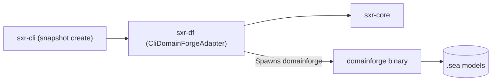

# Subsystem Guide: `sxr-df`

`sxr-df` implements the `SemanticSourcePort` interface by connecting SXR to the external `domainforge` CLI compiler. It parses declarative `.sea` models, extracts semantic representations ($D$), validates CEP envelopes, and produces structured `SemanticContext` objects.

---

## 1. Purpose
To extract declarative semantics from `.sea` models using DomainForge, ensuring that valid models produce content-addressed semantic snapshots while invalid models produce explicit, traceable omission records rather than dummy hashes.

---

## 2. Responsibilities
- Implement `SemanticSourcePort` via `CliDomainForgeAdapter` (`adapter.rs`).
- Execute the `domainforge` binary with appropriate CLI flags (`envelope --emit both`, `--scope`, optional `--registry`).
- Guard child process execution with strict bounds: 16 MiB maximum stdout and stderr reader limits, and a 30-second timeout with forceful process termination.
- Classify DomainForge output **strictly by envelope shape**, never by shell exit code.
- Extract representations ($D$), content hashes, and semantic closure hashes when construction succeeds, carrying the producer's real `model_validation_status` (`"valid"` or `"invalid"`).
- Extract typed `OmissionRecord` items and diagnostic lists when construction fails (e.g. invalid syntax).
- Materialize large representation documents into Content-Addressable Storage (`cas://sha256:<hex>`).

---

## 3. Non-Responsibilities
- **Language Parsing**: Does not compile or parse `.sea` grammar directly; delegates compilation to `domainforge`.
- **Ledger Storage**: Does not append snapshots to the SQLite ledger (delegated to `sxr-cli`).
- **Graph Materialization**: Does not project declarations into relational tables.

---

## 4. Position in the System
`sxr-df` depends on `sxr-core`. It is invoked by `sxr-cli` during `sxr snapshot create`.

---

## 5. Core Abstractions

| Symbol | Location | Description |
| :--- | :--- | :--- |
| `struct CliDomainForgeAdapter` | [`src/adapter.rs`](file:///home/sprime01/projects/sxr/sxr-df/src/adapter.rs) | Adapter invoking the external DomainForge binary via subprocess with bounded I/O and timeouts. |
| `struct SemanticContextRequest` | [`src/adapter.rs`](file:///home/sprime01/projects/sxr/sxr-df/src/adapter.rs) | Input request specifying `semantic_root`, `entry_logical_path`, registry, and packs. |
| `struct AdapterCapabilities` | [`src/adapter.rs`](file:///home/sprime01/projects/sxr/sxr-df/src/adapter.rs) | Describes adapter capabilities (`producer`, `cep_envelope_mode`, etc.). |
| `enum SemanticError` | [`src/error.rs`](file:///home/sprime01/projects/sxr/sxr-df/src/error.rs) | Typed errors (binary missing, malformed JSON, schema violation, process timeout). |

---

## 6. Internal Operation

### Bounded Subprocess Execution
To protect SXR from hung processes or out-of-memory denial-of-service, `CliDomainForgeAdapter` enforces:
1. **Bounded I/O**: Reads stdout and stderr through dedicated worker threads capped with `.take(16 * 1024 * 1024)` (16 MiB).
2. **Timeout & Process Reclaim**: Polls the spawned child process up to 30 seconds. If exceeded, forcefully terminates the child via `kill()` and reaps the exit status.
3. **Registry Forwarding**: Forwards `request.registry_path` via `--registry` if configured.

### Classification by Envelope Shape
DomainForge may exit with code 1 for multiple different reasons (syntax error, type failure, missing import). Instead of relying on exit codes, `CliDomainForgeAdapter` inspects the emitted CEP envelope:
1. **Resolved (`SemanticContext::Resolved`)**:
   - The representation document $D$ is present (either inline in `representations` or materialized via CAS).
   - Extracts `representation_json`, computes `content_hash` and `semantic_closure_hash`, and extracts declaration keys (`DeclKey`).
   - Extracts the producer's real `model_validation_status` (`"valid"` or `"invalid"`) from `extensions.domainforge.model_validation_status` and `representations[0].validation_status`. Models with semantic violations still resolve with their declarations and diagnostics preserved.
2. **Validation Failed (`SemanticContext::ValidationFailed`)**:
   - Representations section is absent, but envelope is conformant to CEP-0008 schema carrying an explicit omission record (`omission_type: "representation_unavailable"`).
   - SXR extracts the omission record and diagnostics, and binds the checkpoint hash to the exact failed inputs digest. **It never synthesizes placeholder hashes.**
3. **Malformed Output**:
   - If the emitted envelope violates schema or does not conform to either shape, the adapter fails closed with `SemanticError::MalformedEnvelope`.

### CAS Representation Materialization
When `cas_root` is supplied in the request and DomainForge returns a large representation with a `content_ref` URI (`cas://sha256:<hex>`), the adapter writes the verified representation bytes directly into `<cas_root>/sha256/` and ensures its content hash matches.

---

## 7. State
Stateless. Spawns ephemeral `domainforge` processes and optionally writes blobs into the designated CAS directory.

---

## 8. Lifecycle
Invoked when `sxr snapshot create` is executed. The path to the `domainforge` binary is determined by the `SXR_DOMAINFORGE_BIN` environment variable or resolved from system `PATH`.

---

## 9. Failure Modes & Diagnostic Codes
- `SemanticError::BinaryNotFound`: The `domainforge` binary was not found or is not executable.
- `SemanticError::MalformedEnvelope`: DomainForge produced JSON that does not parse as a CEP envelope.
- `SemanticError::HashMismatch`: The recomputed hash of representation $D$ does not match the hash declared in the envelope.

---

## 10. Extension Points
- Implement alternative `SemanticSourcePort` adapters (e.g. an in-process Rust compiler or WebAssembly bridge) returning `SemanticContext`.

---

## 11. Source Trail
- [`sxr-df/src/lib.rs`](file:///home/sprime01/projects/sxr/sxr-df/src/lib.rs) — Subsystem exports.
- [`sxr-df/src/adapter.rs`](file:///home/sprime01/projects/sxr/sxr-df/src/adapter.rs) — Subprocess invocation, envelope parsing, and context classification.
- [`sxr-df/src/error.rs`](file:///home/sprime01/projects/sxr/sxr-df/src/error.rs) — Error definitions.
- [`sxr-df/tests/real_binary_tests.rs`](file:///home/sprime01/projects/sxr/sxr-df/tests/real_binary_tests.rs) — Integration tests with the real DomainForge binary.
- [`sxr-df/tests/fixture_tests.rs`](file:///home/sprime01/projects/sxr/sxr-df/tests/fixture_tests.rs) — Offline fixture tests for valid and invalid envelope shapes.
