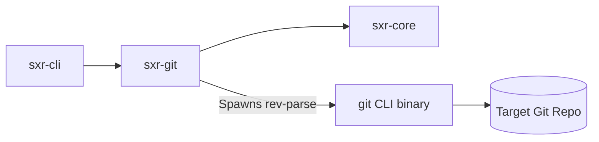

# Subsystem Guide: `sxr-git`

`sxr-git` implements the `RepositoryDiscoveryPort` for SXR. It executes Git discovery via standard CLI commands, mints immutable ULID identifiers, captures discovery evidence, and evaluates continuity verdicts across repository moves or checkouts.

---

## 1. Purpose
To discover, inspect, and track Git repositories without deriving identity from mutable Git properties or mutating the repository checkout.

---

## 2. Responsibilities
- Discover Git root, common directory, current commit, branch, and dirty status via `git rev-parse` and `git status` (`discovery.rs`).
- Mint fresh ULID identifiers for `repo_id` and `checkout_id` at enrollment (`identity.rs`).
- Construct immutable `IdentityEvidence` records capturing Git properties at enrollment time.
- Compare candidate checkouts against known enrollments and produce typed `ContinuityVerdict` evaluations (`matcher.rs`).
- Strictly preserve repository non-mutation (AC-SECURITY-001).

---

## 3. Non-Responsibilities
- **Git Modification**: Does not perform `git commit`, `git checkout`, `git reset`, or write to the `.git` folder.
- **C Library Bindings**: Does not link against `libgit2`; uses standard `Command::new("git")` for broad portability.
- **Semantic Parsing**: Does not inspect code or `.sea` models inside the repository.

---

## 4. Position in the System
`sxr-git` depends only on `sxr-core`. It is invoked by `sxr-cli` during repository enrollment (`sxr repo enroll`) and during verification runs to verify working tree status.

---

## 5. Core Abstractions

| Symbol | Location | Description |
| :--- | :--- | :--- |
| `struct RepoEvidence` | [`src/discovery.rs`](file:///home/sprime01/projects/sxr/sxr-git/src/discovery.rs) | Snapshot of discovered Git state: `git_common_dir`, `git_dir`, `head_commit`, `branch`, `dirty`. |
| `struct IdentityEvidence` | [`src/identity.rs`](file:///home/sprime01/projects/sxr/sxr-git/src/identity.rs) | Immutable record binding minted ULIDs to discovered Git properties at enrollment. |
| `struct CheckoutIdentity` | [`src/identity.rs`](file:///home/sprime01/projects/sxr/sxr-git/src/identity.rs) | Pair of minted ULIDs: `{ repo_id, checkout_id }`. |
| `enum ContinuityVerdict` | [`src/identity.rs`](file:///home/sprime01/projects/sxr/sxr-git/src/identity.rs) | Typed verdict comparing a candidate against prior enrollment (`ExactMatch`, `Relocated`, `DifferentBranch`, `Disjoint`). |
| `trait GitRunner` | [`src/discovery.rs`](file:///home/sprime01/projects/sxr/sxr-git/src/discovery.rs) | Mockable trait for executing Git CLI commands. |

---

## 6. Internal Operation

### The Discovery Sequence (§9.2)
When inspecting a target directory:
1. `git rev-parse --show-toplevel`: Discovers the working tree root.
2. `git rev-parse --git-dir`: Discovers the active Git directory.
3. `git rev-parse --git-common-dir`: Discovers the primary repository directory (supporting linked worktrees).
4. `git rev-parse HEAD`: Resolves the current 40-character commit hash (or `None` for unborn branches).
5. `git symbolic-ref --short HEAD`: Resolves the current branch name (or `None` if detached).
6. `git status --porcelain`: Checks whether uncommitted changes exist (`dirty: bool`).

### Identity Minting (AC-IDENTITY-001)
At enrollment:
- `repo_id = ulid::Ulid::new().to_string()`
- `checkout_id = ulid::Ulid::new().to_string()`
- The minted IDs are permanently decoupled from Git commits. Even if Git history is rewritten (`rebase -i` or `filter-branch`), the SXR repository identity remains stable.

### Continuity Matching (Never Merge)
When SXR inspects a path to determine if it belongs to an already-enrolled repository, `match_continuity` evaluates the evidence:
- **`ExactMatch`**: Same filesystem path, same common dir, same commit.
- **`Relocated`**: Directory moved on disk, but common dir matches.
- **`DifferentBranch`**: Same repo, but HEAD has moved to another branch/commit.
- **`Disjoint`**: Unrelated repository.
> **Rule**: SXR never merges disjoint repositories, even if they share project names or files.

---

## 7. State
Stateless. Spawns ephemeral `git` processes and returns structured memory records.

---

## 8. Lifecycle
Invoked on demand whenever repository state or checkout identity is queried.

---

## 9. Failure Modes & Diagnostic Codes
- `DiscoveryError::NotAGitRepo`: Directory does not contain a `.git` file/directory.
- `DiscoveryError::GitExecFailed`: The `git` executable was not found on `PATH` or returned an unexpected error.
- `DiscoveryError::ParseError`: Output from `git rev-parse` was malformed.

---

## 10. Extension Points
- **Custom `GitRunner`**: Implement the `GitRunner` trait to simulate Git repository states in unit tests without creating real Git directories on disk.

---

## 11. Source Trail
- [`sxr-git/src/lib.rs`](file:///home/sprime01/projects/sxr/sxr-git/src/lib.rs) — Subsystem exports.
- [`sxr-git/src/discovery.rs`](file:///home/sprime01/projects/sxr/sxr-git/src/discovery.rs) — Rev-parse discovery sequence.
- [`sxr-git/src/identity.rs`](file:///home/sprime01/projects/sxr/sxr-git/src/identity.rs) — Identity minting and evidence structures.
- [`sxr-git/src/matcher.rs`](file:///home/sprime01/projects/sxr/sxr-git/src/matcher.rs) — Continuity matching logic.
- [`sxr-git/tests/ac_identity.rs`](file:///home/sprime01/projects/sxr/sxr-git/tests/ac_identity.rs) — Tests validating identity isolation and continuity rules.
