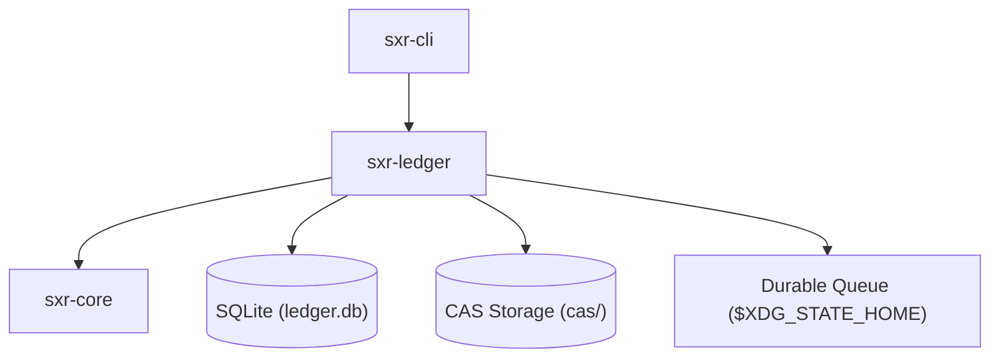

# Subsystem Guide: `sxr-ledger`

`sxr-ledger` is the durable persistence engine of SXR. It manages the SQLite database holding the append-only ledger and transactional outbox, enforces writer serialization using advisory file locks, tracks generation history, provides Content-Addressable Storage (CAS) for large representations, and operates the durable commit queue.

---

## 1. Purpose
To provide durable, crash-resilient, and cryptographically verifiable storage for SXR events, ensuring that committed history cannot be mutated, reordered, or lost.

---

## 2. Responsibilities
- Manage the SQLite database connection, WAL mode, and schema migrations (`schema.rs`, `ledger.rs`).
- Serialize appends using POSIX advisory file locking on `writer.lock` (`writer_lock.rs`).
- Append validated records to the `ledger` table with dense, gapless `append_ordinal` and hash chaining.
- Insert records into the `outbox` table within the same transaction to drive asynchronous projections.
- Store large payloads in filesystem Content-Addressable Storage (`cas.rs`).
- Operate the filesystem-backed durable commit queue and receipt generation (`queue.rs`).
- Quarantine invalid or unparseable envelopes (`quarantine.rs`).
- Track ledger generation transitions and record destructive recovery events (`generation.rs`, `history.rs`).
- Probe filesystem capabilities (locking, fsync support) (`capability.rs`).

---

## 3. Non-Responsibilities
- **Envelope Validation**: Does not parse or validate the semantic contents of CEP envelopes (delegated to `sxr-core`).
- **Projection Materialization**: Does not construct the relational or graph projection tables (delegated to `sxr-cli::projections`).
- **Process Orchestration**: Does not execute verifier or DomainForge processes.

---

## 4. Position in the System
`sxr-ledger` depends on `sxr-core`. It is consumed directly by `sxr-cli` (for CLI commands and projections) and by the background daemon (`sxr-cli::daemon`).

---

## 5. Core Abstractions

| Symbol | Location | Description |
| :--- | :--- | :--- |
| `struct Ledger` | [`src/ledger.rs`](file:///home/sprime01/projects/sxr/sxr-ledger/src/ledger.rs) | Primary handle to the SQLite database, managing transactions and appends. |
| `struct WriterLock` | [`src/writer_lock.rs`](file:///home/sprime01/projects/sxr/sxr-ledger/src/writer_lock.rs) | RAII wrapper around `libc::flock(fd, LOCK_EX)` on `writer.lock`. |
| `enum AppendOutcome` | [`src/ledger.rs`](file:///home/sprime01/projects/sxr/sxr-ledger/src/ledger.rs) | Result of an append: either `Committed { position, entry_hash }` or `AlreadyCommitted { position }`. |
| `struct Cas` | [`src/cas.rs`](file:///home/sprime01/projects/sxr/sxr-ledger/src/cas.rs) | Content-addressable storage engine reading/writing blobs under `cas/sha256/`. |
| `struct QueueReceipt` | [`src/queue.rs`](file:///home/sprime01/projects/sxr/sxr-ledger/src/queue.rs) | Fsynced receipt issued to daemon clients confirming a segment is durable. |
| `struct LedgerHistory` | [`src/history.rs`](file:///home/sprime01/projects/sxr/sxr-ledger/src/history.rs) | Graph of ledger generations tracking predecessor lineages. |

---

## 6. Internal Operation

### The Append Transaction
When `Ledger::append()` is called with a `PendingEntry`:
1. Opens an `IMMEDIATE` transaction in SQLite.
2. Checks for deduplication: if `idempotency_key` is present and exists in `ledger`, returns `AppendOutcome::AlreadyCommitted`.
3. Reads the current maximum `append_ordinal` and `entry_hash` (the previous entry).
4. Assigns `append_ordinal = max + 1`. If the table is empty, ordinal is 1 and `previous_entry_hash = NULL`.
5. Mints a time-ordered ULID (`entry_ulid`) if not pre-supplied.
6. Computes `payload_hash = SHA256(payload)`.
7. Computes `entry_hash = sxr_core::chain::entry_hash(...)`.
8. Inserts the row into `ledger`.
9. Inserts a row into `outbox` naming default projectors.
10. Commits the transaction and returns `AppendOutcome::Committed`.

### Idempotency & Deduplication
The `idempotency_key` column has a `UNIQUE` constraint. Duplicate submissions (e.g. from retried daemon segments or network retransmissions) do not create duplicate rows; they resolve to the existing committed position.

---

## 7. State
- **Persistent State**:
  - `ledger.db`: The SQLite database file.
  - `writer.lock`: File used for kernel advisory locks.
  - `cas/`: Content-addressed binary store.
  - `daemon-queue/`: Directory containing `<ulid>.segment` and `<ulid>.receipt` files.

---

## 8. Lifecycle
- Opened via `Ledger::open(db_path, repo_id, config)`.
- If `user_version` is 0, applies `full_ddl()` (`ledger` + `outbox` + `projection_watermark`) and sets `user_version = 1`.
- Closes cleanly when the `Ledger` struct is dropped.

---

## 9. Failure Modes & Diagnostic Codes
- `Error::LockTimeout`: Failed to acquire `writer.lock` within the 30-second window.
- `Error::ChainDivergence`: In-memory row hash did not match recomputed hash during verification.
- `Error::CorruptSegment`: A queue segment failed its integrity check during recovery.
- `Error::Sqlite`: Native SQLite error (e.g., constraint violation, disk full).

---

## 10. Extension Points
- **Custom Projectors**: Register custom projector keys in the `outbox` table and drain them via `sxr_ledger::outbox::drain_pending`.
- **Alternative CAS Storage**: The CAS path layout can be reconfigured via `Cas::open`.

---

## 11. Source Trail
- [`sxr-ledger/src/lib.rs`](file:///home/sprime01/projects/sxr/sxr-ledger/src/lib.rs) — Subsystem root.
- [`sxr-ledger/src/schema.rs`](file:///home/sprime01/projects/sxr/sxr-ledger/src/schema.rs) — DDL statements and schema version guards.
- [`sxr-ledger/src/ledger.rs`](file:///home/sprime01/projects/sxr/sxr-ledger/src/ledger.rs) — Core append and verification algorithms.
- [`sxr-ledger/src/writer_lock.rs`](file:///home/sprime01/projects/sxr/sxr-ledger/src/writer_lock.rs) — Advisory file locking implementation.
- [`sxr-ledger/src/queue.rs`](file:///home/sprime01/projects/sxr/sxr-ledger/src/queue.rs) — Commit queue segment management.
- [`sxr-ledger/tests/ac_ledger_001.rs`](file:///home/sprime01/projects/sxr/sxr-ledger/tests/ac_ledger_001.rs) — Append and hash chain integrity tests.
- [`sxr-ledger/tests/ac_ledger_002.rs`](file:///home/sprime01/projects/sxr/sxr-ledger/tests/ac_ledger_002.rs) — Generation history and outbox watermark tests.
