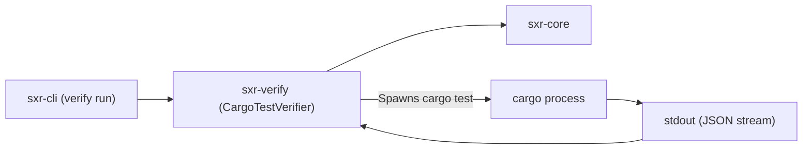

# Subsystem Guide: `sxr-verify`

`sxr-verify` implements the `VerifierPort` interface for SXR. It manages the execution of test runners and verification tools (specifically `cargo test`), captures process stdout and stderr, parses test event streams, and emits raw `observation.recorded` payloads.

---

## 1. Purpose
To execute test suites and verification tools in a clean, filtered environment and capture their raw execution telemetry as unopinionated observations, strictly preventing test runners from directly asserting evidence or settlement.

---

## 2. Responsibilities
- Implement the `VerifierPort` trait and register the `cargo-test` verifier (`port.rs`, `verifier.rs`).
- Scrub environment variables (`filtered_env`) before spawning verifier processes.
- Execute verifiers under specified working directories and capture stdout, stderr, and exit codes.
- Parse structured output formats (specifically `cargo-json`) into `ParsedSummary` counts (`passed`, `failed`, `ignored`).
- Compute SHA-256 digests over execution logs for immutable artifact reference.
- Map verifier exit codes to preliminary observation direction (`direction_for`).

---

## 3. Non-Responsibilities
- **Evidence Derivation**: Does not determine evidence relevance, reliability, or question bindings (delegated to `sxr-cli::commands::evidence_create`).
- **Settlement Evaluation**: Does not evaluate thresholds or decide if tests "passed" for the domain model.
- **Ledger Persistence**: Does not write rows to `ledger.db`.

---

## 4. Position in the System
`sxr-verify` depends on `sxr-core`. It is invoked by `sxr-cli` during `sxr verify run`.

---

## 5. Core Abstractions

| Symbol | Location | Description |
| :--- | :--- | :--- |
| `trait VerifierPort` | [`src/port.rs`](file:///home/sprime01/projects/sxr/sxr-verify/src/port.rs) | Interface defining `describe()` and `execute()` for verifiers. |
| `struct CargoTestVerifier` | [`src/verifier.rs`](file:///home/sprime01/projects/sxr/sxr-verify/src/verifier.rs) | The default verifier executing `cargo test --message-format json`. |
| `struct VerificationStep` | [`src/port.rs`](file:///home/sprime01/projects/sxr/sxr-verify/src/port.rs) | Represents a planned execution step binding a verifier ID to an invocation. |
| `struct VerifierOutcome` | [`src/port.rs`](file:///home/sprime01/projects/sxr/sxr-verify/src/port.rs) | Execution telemetry: exit code, duration, artifact digests, and parsed summary. |
| `struct ParsedSummary` | [`src/port.rs`](file:///home/sprime01/projects/sxr/sxr-verify/src/port.rs) | Parsed test counts: `passed`, `failed`, `ignored`, `measured`, `filtered_out`. |
| `fn direction_for` | [`src/port.rs`](file:///home/sprime01/projects/sxr/sxr-verify/src/port.rs) | Maps exit code to `EvidenceDirection` based on declared direction rule (`supports` on 0, `contradicts` on non-zero). |

---

## 6. Internal Operation

### Execution Sequence
When `CargoTestVerifier::execute` runs:
1. Validates that `Cargo.toml` exists in the invocation directory.
2. Creates an ephemeral artifacts directory under `<ctx.artifacts_dir>`.
3. Sanitizes environment variables using `filtered_env()` (strips cargo recursion vars, internal telemetry tokens).
4. Spawns `cargo test --message-format json` capturing stdout and stderr.
5. Hashes stdout and stderr as they stream into artifact log files (`stdout.log`, `stderr.log`).
6. Awaits process completion and captures the numeric exit code.
7. Parses the stdout stream using `parse_cargo_json` to extract individual test suite results and total passed/failed counts.
8. Constructs and returns `VerifierOutcome`.

### The Anti-Collapse Rule for Verifiers
`sxr-verify` deliberately returns **observations only**. It has no concept of "the test passed the user requirement". The observation merely states: *"Subprocess exited 0 with 42 passed tests"*. Epistemic meaning is assigned later by `sxr evidence create`.

---

## 7. State
Stateless. Spawns external processes and writes log artifacts to caller-supplied directories.

---

## 8. Lifecycle
Invoked when `sxr verify run --run <run_id>` executes a planned step.

---

## 9. Failure Modes & Diagnostic Codes
- `VerifierError::NotARepo`: Working directory is missing `Cargo.toml`.
- `VerifierError::UnsupportedVerifier`: Plan requested a verifier ID other than `cargo-test`.
- `VerifierError::ProcessSpawnFailed`: Failed to execute the `cargo` binary.
- `VerifierError::Timeout`: Execution exceeded configured plan step timeout.

---

## 10. Extension Points
- **Add New Verifiers**: Implement `VerifierPort` for other tools (e.g. `pytest`, `go test`, `eslint`, `tla+`). See [How to Add a Verifier](../how-to/add-verifier.md).

---

## 11. Source Trail
- [`sxr-verify/src/lib.rs`](file:///home/sprime01/projects/sxr/sxr-verify/src/lib.rs) — Subsystem root.
- [`sxr-verify/src/port.rs`](file:///home/sprime01/projects/sxr/sxr-verify/src/port.rs) — Port definitions, step shapes, and direction mapping.
- [`sxr-verify/src/verifier.rs`](file:///home/sprime01/projects/sxr/sxr-verify/src/verifier.rs) — `CargoTestVerifier` implementation.
- [`sxr-verify/src/cargo_json.rs`](file:///home/sprime01/projects/sxr/sxr-verify/src/cargo_json.rs) — JSON stream parser for cargo test events.
