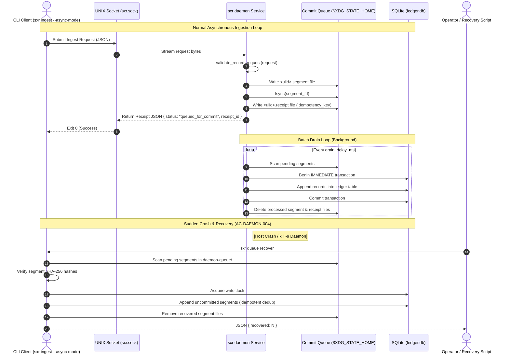

# Workflow Trace: Daemon Ingestion & Durability Recovery (Slice 6)

This document traces the asynchronous daemon ingestion protocol, commit queue fsync guarantees, batch ledger commits, and crash recovery mechanics under sudden process termination (`SIGKILL`).

---

## 1. Summary
The `sxr daemon` provides a high-throughput UNIX socket interface that holds the ledger writer lock, validates incoming envelope requests, appends them to a durable commit queue with fsynced receipts, and drains segments into the ledger in batches. If the process crashes immediately after issuing a receipt, `sxr queue recover` commits the pending segments exactly once, maintaining complete record parity with direct execution.

---

## 2. Sequence Diagram

---

## 3. Detailed Step-by-Step Path

### 1. Ingestion Submission (`sxr ingest --async-mode`)
- Formats envelope request as `sxr.record/v1` carrying `record_kind`, `idempotency_key`, `subject_refs`, and the CEP `envelope`.
- Connects to the socket path (`$XDG_RUNTIME_DIR/sxr.sock` or `SXR_DAEMON_SOCKET`).
- If socket connection fails, falls back transparently to a direct, synchronous commit (`"daemon": false`) (AC-DAEMON-002).

### 2. Daemon Segment Persistence
- `daemon::daemon_run` listens on the UNIX socket.
- Invokes [`sxr_cli::daemon::validate_record_request`](file:///home/sprime01/projects/sxr/sxr-cli/src/daemon.rs): verifies schema, known record kind, and required fields.
- Calls [`sxr_ledger::queue::enqueue`](file:///home/sprime01/projects/sxr/sxr-ledger/src/queue.rs):
  - Mints segment ULID.
  - Computes request hash: $H = \text{SHA256}(\text{request})$.
  - Writes `<ulid>.segment` containing header `sxr.segment/v1` and payload.
  - Calls `file.sync_all()` (`fsync`).
  - Writes `<ulid>.receipt` linking segment ULID, idempotency key, and request hash.
- Transmits JSON receipt to client and flushes socket.

### 3. Background Batch Commit
- The daemon loop wakes up every `drain_delay_ms` (default: 250ms).
- Calls [`sxr_ledger::queue::drain`](file:///home/sprime01/projects/sxr/sxr-ledger/src/queue.rs).
- For each valid segment:
  - Appends to `ledger.db` using the held writer lock.
  - Upon successful SQLite commit, unlinks the segment and receipt files.

---

## 4. Crash Invariants & Durability Guarantees

### Kill -9 after Receipt (AC-DAEMON-004)
If the daemon is killed with `kill -9` after the client receives an exit code 0 receipt, the segment remains intact on disk:
- Running `sxr queue recover` scans the directory, validates hashes, acquires the writer lock, and appends the pending segments.
- If a crash occurred *after* SQLite commit but *before* queue unlinking, re-running recovery is completely safe: the `idempotency_key` unique constraint in `ledger.db` causes the duplicate to resolve to the existing committed position without creating redundant rows.

### Corrupt & Torn Segment Handling
If a power failure causes a partial or torn segment write:
- The segment's recomputed SHA-256 does not match the header hash.
- **Fail-Closed Rule**: The corrupt segment is **never deleted or silently repaired**. It is frozen on disk for forensic inspection.
- `sxr doctor` detects the corrupt segment and exits with code **2**.
- `sxr queue recover` refuses to proceed and exits with code **3** naming the corrupt segment.

---

## 5. Source Trail
- [`sxr-cli/src/daemon.rs`](file:///home/sprime01/projects/sxr/sxr-cli/src/daemon.rs) — Daemon server implementation and client IPC submission.
- [`sxr-ledger/src/queue.rs`](file:///home/sprime01/projects/sxr/sxr-ledger/src/queue.rs) — Queue segment serialization, fsync, and scan logic.
- [`sxr-cli/src/durability.rs`](file:///home/sprime01/projects/sxr/sxr-cli/src/durability.rs) — Durability state scanner.
- [`proof/slice6.sh`](file:///home/sprime01/projects/sxr/proof/slice6.sh) — Gate 6 proof script proving daemon parity, kill -9 recovery, and torn segment handling.
