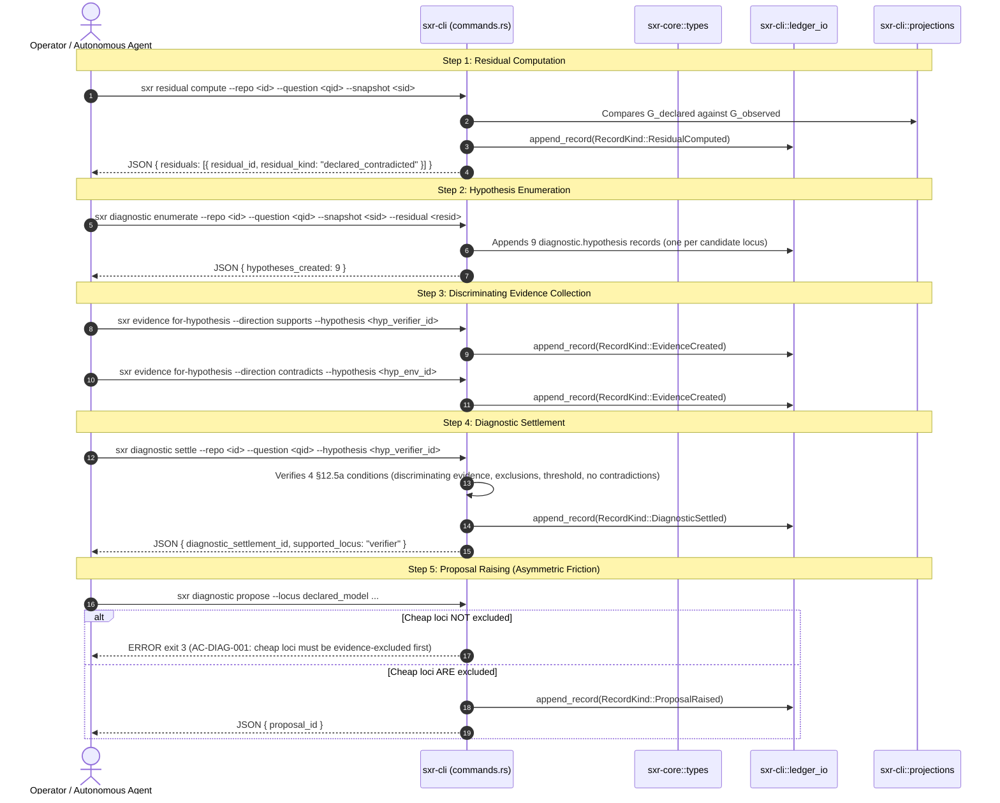

# Workflow Trace: Diagnostic Attribution Loop (Slice 5)

This document traces the execution of the Slice 5 failure attribution loop (§12.5a). When automated verification contradicts declared semantics, SXR isolates the failure across 9 candidate loci and enforces asymmetric friction before permitting model-level repair proposals.

---

## 1. Summary
Automated developer agents frequently misdiagnose verification failures: if a test panics due to an environmental missing variable or flaky test harness, the agent erroneously rewrites working business models. SXR prevents this by treating disagreements as unassigned **Residuals**, generating 9 mutually exclusive failure loci hypotheses, and refusing to allow model-level repair proposals until cheap infrastructure and verifier loci have been systematically excluded with evidence.

---

## 2. Sequence Diagram

---

## 3. The 9 Candidate Failure Loci

When `sxr diagnostic enumerate` runs, it generates one `diagnostic.hypothesis` record for each of the 9 candidate failure loci:

| Failure Locus | Description | Cost to Fix |
| :--- | :--- | :--- |
| **`verifier`** | The test harness itself is broken, flaky, or asserting the wrong invariant. | Low |
| **`environment`** | Missing system dependency, port conflict, or OS configuration defect. | Low |
| **`specification`** | The test expectation or contract configuration was specified incorrectly. | Low |
| **`contract`** | Mismatch between the imported verification contract and the local target. | Low |
| **`runtime`** | Defect in the execution runner or subprocess orchestrator. | Medium |
| **`implementation`** | Defect in the target software code implementing the model. | Medium |
| **`declared_model`** | The high-level `.sea` architectural or semantic model is flawed. | **High (Expensive)** |
| **`translation`** | Defect in the code generation or model-to-code mapping. | High |
| **`ambiguity`** | The observation is genuinely ambiguous and cannot be classified. | N/A |

---

## 4. The 4 Conditions for Diagnostic Settlement (§12.5a)

To promote a candidate hypothesis to `diagnostic.settled` (`sxr diagnostic settle`), all four conditions must be met:
1. **Discriminating Evidence**: At least one qualifying evidence record explicitly supports the candidate hypothesis (`supports`).
2. **Alternative Exclusion**: All competing candidate hypotheses have been either falsified with contradicting evidence (`contradicts`) or formally excluded by declared dependency rules.
3. **Threshold Satisfaction**: The supporting evidence meets the diagnostic question's pre-registered threshold.
4. **Zero Unadjudicated Contradictions**: No conflicting evidence exists targeting the supported hypothesis without an explicit resolution.

If any condition fails, `sxr diagnostic settle` exits with code **3** and states which condition was unmet.

---

## 5. Asymmetric Friction against Model Blame (AC-DIAG-001)

SXR enforces **asymmetric friction**:
- Raising a proposal for a cheap locus (`verifier`, `environment`, `implementation`) is allowed as soon as that locus is diagnostically settled.
- Raising a proposal for **`declared_model`** requires that all cheaper loci (`verifier`, `environment`, `specification`, `contract`) have been **evidence-excluded** (i.e. possess explicit contradicting evidence).
- If an agent attempts to raise a model repair proposal while the verifier or environment locus remains unadjudicated, SXR halts execution with exit code 3.

---

## 6. State Changes
- New rows in `sxr_residual`: Stores the residual with `attribution_status` transitioning from `undiagnosed` to `settled`.
- 9 rows in `sxr_hypothesis`: Each candidate failure locus.
- Row in `sxr_diag_settlement`: Records the settled locus.
- Row in `sxr_proposal`: Records the repair proposal bound to the settlement.

---

## 7. Source Trail
- [`sxr-cli/src/commands.rs`](file:///home/sprime01/projects/sxr/sxr-cli/src/commands.rs) — Handlers for `residual_compute`, `diagnostic_enumerate`, `diagnostic_settle`, and `diagnostic_propose`.
- [`sxr-cli/src/projections.rs`](file:///home/sprime01/projects/sxr/sxr-cli/src/projections.rs) — DDL and tables for `sxr_residual`, `sxr_hypothesis`, `sxr_diag_settlement`, and `sxr_proposal`.
- [`proof/slice5.sh`](file:///home/sprime01/projects/sxr/proof/slice5.sh) — Gate 5 proof script verifying the diagnostic loop and AC-DIAG-001 enforcement.
