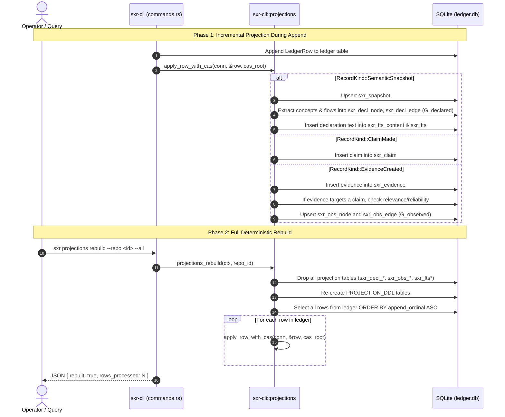

# Workflow Trace: Graph Projections & Rebuild Determinism

This document traces how SXR derives relational and graph read models from immutable ledger records, specifically the declared graph ($G_{declared}$), the observed graph ($G_{observed}$), and the contentless FTS5 search index.

---

## 1. Summary
SXR separates write-optimized append operations from read-optimized graph and search queries via CQRS. As events are appended to the ledger, projectors populate $G_{declared}$ (nodes/edges defined in `.sea` models), $G_{observed}$ (relationships proven by qualifying evidence targeting explicit claims), and an FTS5 full-text index. Projections can be wiped and reconstructed from scratch, guaranteeing byte-identical canonical JSON output across rebuilds.

---

## 2. Sequence Diagram

---

## 3. Detailed Path & Invariants

### 1. The Declared Graph ($G_{declared}$)
- **Source Record**: `semantic.snapshot`.
- **Tables**: `sxr_decl_node` and `sxr_decl_edge`.
- **Node Scoping (AC-IDENTITY-002)**: Nodes are keyed by `(snapshot_id, decl_key)`. Because snapshots belong to a specific `repo_id`, identical declaration keys in different repositories or checkouts remain completely disjoint.
- **Edge Extraction**: Extracted from resolved references and flow definitions in the representation document ($D$).

### 2. The Observed Graph ($G_{observed}$)
- **Source Records**: `claim.made` and `evidence.created`.
- **Tables**: `sxr_obs_node` and `sxr_obs_edge`.
- **Admission Invariant (AC-GRAPH-001)**:
  - An edge between two declarations is admitted **only** when an explicit `claim.made` asserts the relation and at least one `evidence.created` targets that claim meeting the question's minimum relevance and reliability.
  - **Co-reference never creates an edge**: Two declarations sharing a name or appearing in the same test assertion do not form an edge in $G_{observed}$ without explicit qualifying evidence.
  - Unobserved declarations have no node in $G_{observed}$ (rendered as `not_observed`, never as failure).

### 3. Full-Text Search Index (FTS5)
- **Table**: `sxr_fts` (SQLite FTS5 virtual table).
- **Contentless Design**: The index stores no independent text; it references `sxr_fts_content`. When a rebuild occurs, the index is repopulated directly from ledger payloads.

### 4. Rebuild Determinism (AC-REPLAY-002)
When `sxr projections rebuild --repo <id> --all` runs:
1. All projection tables and FTS indexes are dropped.
2. The schema DDL is reapplied.
3. Every row from `ledger` is replayed in strict `append_ordinal` ascending order.
4. Exporting canonical JSON (`sxr projections export --canonical-json`) before and after the rebuild yields **byte-identical output**:
   $$\text{canonical\_json}(\text{projections}_{\text{before}}) == \text{canonical\_json}(\text{projections}_{\text{after}})$$

---

## 4. State Changes
- **Tables Modified**: `sxr_snapshot`, `sxr_run`, `sxr_question`, `sxr_threshold`, `sxr_evidence`, `sxr_settlement`, `sxr_decl_node`, `sxr_decl_edge`, `sxr_claim`, `sxr_obs_node`, `sxr_obs_edge`, `sxr_fts_content`, `sxr_fts`.
- **Ledger Table**: Untouched (read-only during rebuild).

---

## 5. Failure Branches
- **Missing `--all` Flag**: Invoking `projections rebuild` without `--all` fails with exit code 2.
- **CAS Blob Missing**: If a ledger row references `cas://sha256:...` but the blob is missing from `cas/`, the projector returns an error and fails closed.

---

## 6. Source Trail
- [`sxr-cli/src/projections.rs`](file:///home/sprime01/projects/sxr/sxr-cli/src/projections.rs) — `PROJECTION_DDL`, `apply_row_with_cas`, `rebuild_all`, `export_canonical_json`.
- [`proof/slice3.sh`](file:///home/sprime01/projects/sxr/proof/slice3.sh) — Slice 3 proof script validating $G_{declared}$ and FTS5 rebuild determinism.
- [`proof/slice4.sh`](file:///home/sprime01/projects/sxr/proof/slice4.sh) — Slice 4 proof script validating $G_{observed}$ admission and anti-collapse export.
