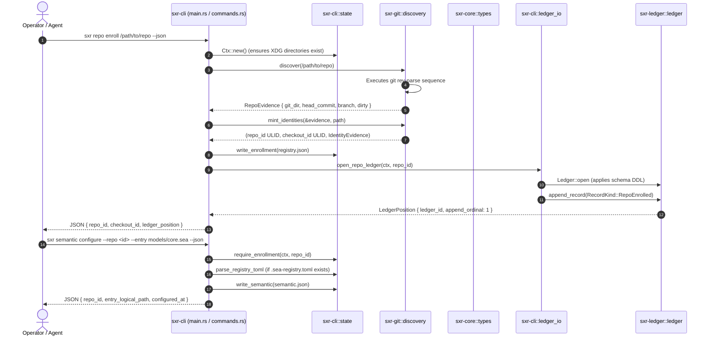

# Workflow Trace: Repository Enrollment & Semantic Configuration

This document traces the complete execution lifecycle of enrolling a Git repository into SXR and configuring its declarative semantic entry point.

---

## 1. Summary
Repository enrollment discovers Git repository metadata via `git rev-parse`, mints fresh ULID identities for the repository and checkout, captures immutable discovery evidence, and initializes local storage sandboxes without creating or modifying any file inside the target repository. Semantic configuration binds the repository to an entry `.sea` model file and parses `.sea-registry.toml` namespace patterns.

---

## 2. Sequence Diagram

---

## 3. Detailed Path & Implementation Symbols

1. **CLI Invocation**:
   - [`sxr-cli/src/main.rs:dispatch`](file:///home/sprime01/projects/sxr/sxr-cli/src/main.rs): Matches `Command::Repo(RepoCmds::Enroll { path })`.
   - Calls [`sxr-cli/src/commands.rs:repo_enroll`](file:///home/sprime01/projects/sxr/sxr-cli/src/commands.rs).
2. **Context & Discovery**:
   - Resolves canonical path and calls [`sxr_git::discovery::discover`](file:///home/sprime01/projects/sxr/sxr-git/src/discovery.rs).
   - Executes `git rev-parse --show-toplevel`, `--git-dir`, `--git-common-dir`, `HEAD`, `symbolic-ref`, and `status --porcelain`.
3. **Identity Minting (AC-IDENTITY-001)**:
   - Calls [`sxr_git::identity::mint_identities`](file:///home/sprime01/projects/sxr/sxr-git/src/identity.rs).
   - Generates fresh ULIDs for `repo_id` and `checkout_id`.
   - Assembles `IdentityEvidence` capturing the exact Git hashes and paths.
4. **Filesystem Sandbox Creation (AC-SECURITY-001)**:
   - Creates directory `$XDG_DATA_HOME/sxr/repos/<repo_id>/`.
   - Writes `registry.json` using [`sxr_cli::state::write_enrollment`](file:///home/sprime01/projects/sxr/sxr-cli/src/state.rs).
5. **Ledger Initialization & Genesis Record**:
   - Acquires `writer.lock` via [`sxr_cli::ledger_io::open_repo_ledger`](file:///home/sprime01/projects/sxr/sxr-cli/src/ledger_io.rs).
   - `Ledger::open` creates `ledger.db` and applies `LEDGER_DDL` and `OUTBOX_DDL` from [`sxr_ledger::schema`](file:///home/sprime01/projects/sxr/sxr-ledger/src/schema.rs).
   - Appends the genesis record `RecordKind::RepoEnrolled` at ordinal 1.
6. **Semantic Configuration**:
   - Command `sxr semantic configure` calls [`sxr_cli::commands::semantic_configure`](file:///home/sprime01/projects/sxr/sxr-cli/src/commands.rs).
   - Checks if `<repo_root>/.sea-registry.toml` exists; hand-parses namespaces using [`sxr_cli::state::parse_registry_toml`](file:///home/sprime01/projects/sxr/sxr-cli/src/state.rs).
   - Writes configuration to `$XDG_DATA_HOME/sxr/repos/<repo_id>/semantic.json`.

---

## 4. State Changes
- **Target Repository**: Zero bytes modified.
- **SXR Data Directory** (`$XDG_DATA_HOME/sxr/repos/<repo_id>/`):
  - `registry.json` created.
  - `semantic.json` created.
  - `writer.lock` created.
  - `ledger.db` created containing ordinal 1 (`repo.enrolled`).

---

## 5. Failure Branches
- **Target Path Not Found**: Exits with code 2 (`path does not exist`).
- **Not a Git Repository**: `discover` fails with `DiscoveryError::NotAGitRepo`; CLI exits with code 2.
- **Repository Already Enrolled**: If path matches an existing enrollment, returns existing `repo_id` idempotently.
- **Missing Semantic Entry File**: `semantic configure` checks that the specified `.sea` file exists relative to the semantic root; exits with code 3 if missing.

---

## 6. Source Trail
- [`sxr-cli/src/commands.rs`](file:///home/sprime01/projects/sxr/sxr-cli/src/commands.rs) — `repo_enroll`, `semantic_configure`.
- [`sxr-git/src/discovery.rs`](file:///home/sprime01/projects/sxr/sxr-git/src/discovery.rs) — `discover`.
- [`sxr-git/src/identity.rs`](file:///home/sprime01/projects/sxr/sxr-git/src/identity.rs) — `mint_identities`.
- [`sxr-cli/src/state.rs`](file:///home/sprime01/projects/sxr/sxr-cli/src/state.rs) — `write_enrollment`, `write_semantic`.
- [`sxr-ledger/src/schema.rs`](file:///home/sprime01/projects/sxr/sxr-ledger/src/schema.rs) — `full_ddl`.
