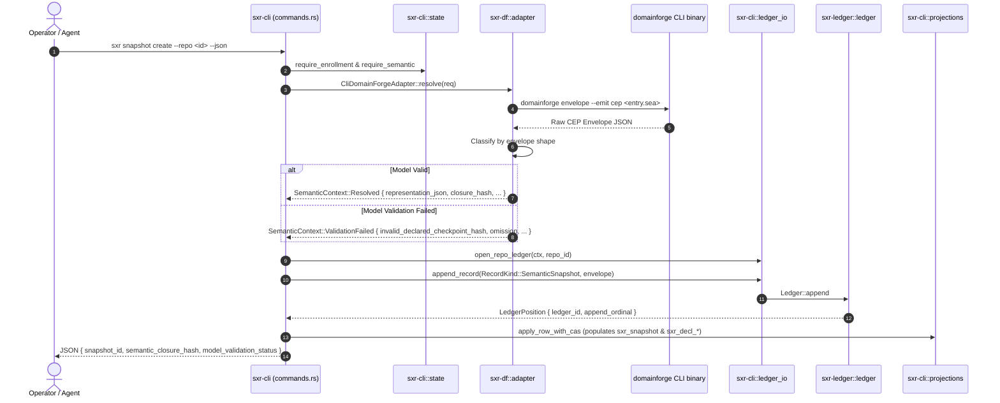

# Workflow Trace: Semantic Snapshot Creation

This document traces how SXR compiles declarative `.sea` models via DomainForge and records immutable `semantic.snapshot` records in the ledger.

---

## 1. Summary
`sxr snapshot create` extracts the declarative domain model from a repository's `.sea` files by invoking DomainForge. If compilation succeeds, SXR records a `semantic.snapshot` envelope carrying representation $D$, declaration keys, and the semantic closure hash. If validation fails, SXR records a schema-valid failure envelope with an explicit `OmissionRecord`, refusing to manufacture dummy checkpoint hashes.

---

## 2. Sequence Diagram

---

## 3. Detailed Path & Implementation Symbols

1. **CLI Invocation**:
   - Matches `Command::Snapshot(SnapshotCmds::Create { repo })` in [`sxr-cli/src/main.rs`](file:///home/sprime01/projects/sxr/sxr-cli/src/main.rs).
   - Calls [`sxr-cli/src/commands.rs:snapshot_create`](file:///home/sprime01/projects/sxr/sxr-cli/src/commands.rs).
2. **Configuration Loading**:
   - Reads `registry.json` and `semantic.json` from `$XDG_DATA_HOME/sxr/repos/<repo_id>/`.
   - Assembles `SemanticContextRequest` specifying `semantic_root`, `entry_logical_path`, and `cas_root`.
3. **DomainForge Execution**:
   - Calls [`sxr_df::adapter::CliDomainForgeAdapter::resolve`](file:///home/sprime01/projects/sxr/sxr-df/src/adapter.rs).
   - Resolves binary path from `SXR_DOMAINFORGE_BIN` or `PATH`.
   - Spawns `domainforge envelope --emit cep ...`.
4. **Envelope Classification**:
   - Parses stdout into JSON.
   - If `validation_status == "validated"` and `representations` array exists:
     - Extracts representation $D$, computes SHA-256 `content_hash` and `semantic_closure_hash`.
     - Extracts declarations into `Vec<DeclKey>`.
     - Returns `SemanticContext::Resolved`.
   - If `conformance_status == "non_conformant"` and `omissions` exists:
     - Extracts `OmissionRecord`.
     - Computes `invalid_declared_checkpoint_hash` from the resolution inputs.
     - Returns `SemanticContext::ValidationFailed`.
5. **Ledger Commit**:
   - Builds `RecordKind::SemanticSnapshot` envelope using [`sxr_cli::envelopes::build`](file:///home/sprime01/projects/sxr/sxr-cli/src/envelopes.rs).
   - Appends to `ledger.db` under the writer lock.
6. **Projection Update**:
   - [`sxr_cli::projections::apply_row_with_cas`](file:///home/sprime01/projects/sxr/sxr-cli/src/projections.rs) upserts `sxr_snapshot`.
   - For valid models, populates $G_{declared}$ tables (`sxr_decl_node`, `sxr_decl_edge`).

---

## 4. State Changes
- **Ledger**: Appends `semantic.snapshot` record at next `append_ordinal`.
- **Projections**:
  - Row added to `sxr_snapshot`.
  - Rows added to `sxr_decl_node` and `sxr_decl_edge` for every concept, entity, and relation.
- **CAS Store** (if representation was large): New blob created at `cas/sha256/<prefix>/<hash>`.

---

## 5. Failure Branches
- **Repo Not Enrolled / Not Configured**: Exits code 3 with missing prerequisite message.
- **DomainForge Binary Missing**: Fails with `SemanticError::BinaryNotFound`; exits code 3.
- **Malformed Compiler Output**: If DomainForge emits unparseable text or an envelope that violates `cep-semantic-envelope.schema.json`, SXR exits code 4 without committing.

---

## 6. Source Trail
- [`sxr-cli/src/commands.rs`](file:///home/sprime01/projects/sxr/sxr-cli/src/commands.rs) — `snapshot_create`.
- [`sxr-df/src/adapter.rs`](file:///home/sprime01/projects/sxr/sxr-df/src/adapter.rs) — `CliDomainForgeAdapter::resolve`.
- [`sxr-core/src/types.rs`](file:///home/sprime01/projects/sxr/sxr-core/src/types.rs) — `SemanticContext`, `OmissionRecord`, `SnapshotRow`.
- [`sxr-cli/src/projections.rs`](file:///home/sprime01/projects/sxr/sxr-cli/src/projections.rs) — `apply_row_with_cas`.
- [`proof/gate1.sh`](file:///home/sprime01/projects/sxr/proof/gate1.sh) — Snapshot creation proof steps.
