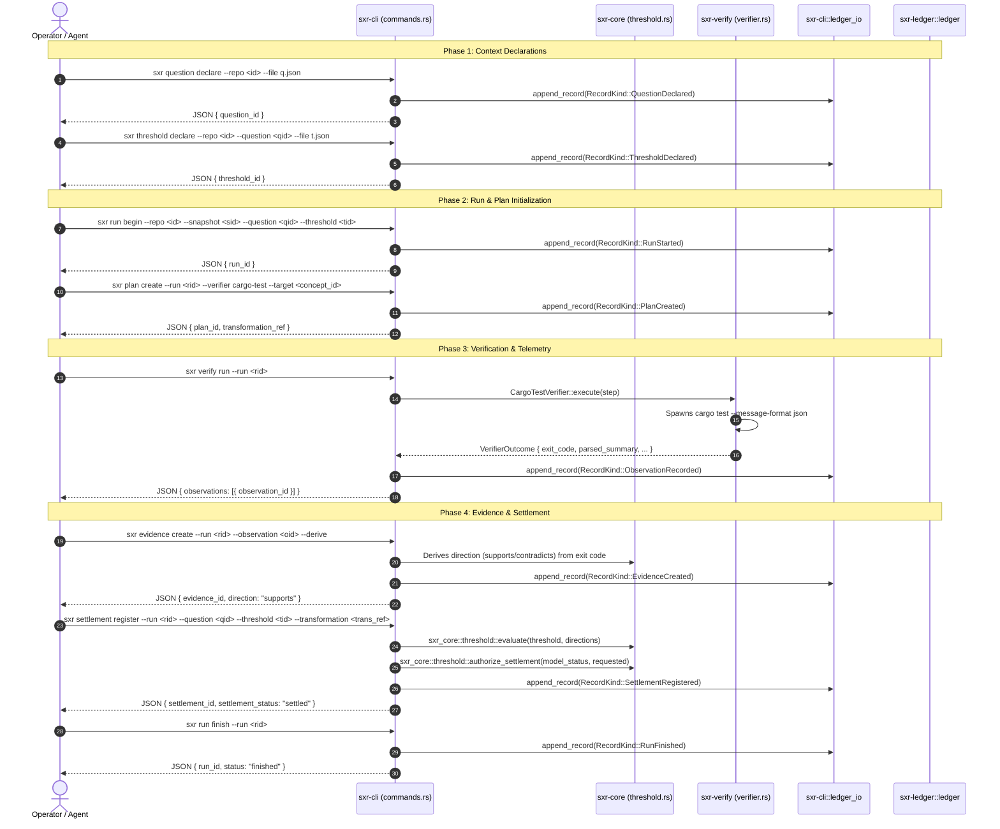

# Workflow Trace: Verification Run & Settlement Lifecycle

This document traces the complete end-to-end verification lifecycle: declaring questions and thresholds, initiating a run, creating and executing test plans, deriving evidence from observations, registering settlements, and finishing the run.

---

## 1. Summary
The verification run lifecycle enforces the complete SXR epistemological pipeline. An operator or agent binds a snapshot, question, and threshold into an active run, executes a verification test plan (`cargo-test`), derives question-bound evidence from raw observations, and deterministically registers a settlement outcome guarded by the AC-SETTLEMENT-002 invariant.

---

## 2. Sequence Diagram

---

## 3. Detailed Step-by-Step Path

### Step 1: Question & Threshold Declaration
- `sxr question declare`: Records a formal CEP Question envelope targeting a concept or property.
- `sxr threshold declare`: Binds a threshold spec (`AllEvidenceSupports`, `AnyEvidenceContradicts`, or `RequiresEvidence`) to the question. Thresholds must be declared **before** observations exist.

### Step 2: Run Initiation (`run begin`)
- Calls [`sxr_cli::commands::run_begin`](file:///home/sprime01/projects/sxr/sxr-cli/src/commands.rs).
- Inspects repository working tree status via `sxr_git::discovery::discover` to record `head_commit` and `dirty` flag.
- Validates that the referenced snapshot, question, and threshold exist in the ledger.
- Appends `RecordKind::RunStarted`.

### Step 3: Verification Plan Creation (`plan create`)
- Calls [`sxr_cli::commands::plan_create`](file:///home/sprime01/projects/sxr/sxr-cli/src/commands.rs).
- Mints a `transformation_ref` URI identifying the planned state change.
- Writes a `RecordKind::PlanCreated` envelope containing the verifier ID (`cargo-test`) and invocation parameters.

### Step 4: Verification Execution (`verify run`)
- Calls [`sxr_cli::commands::verify_run`](file:///home/sprime01/projects/sxr/sxr-cli/src/commands.rs).
- Spawns [`sxr_verify::verifier::CargoTestVerifier::execute`](file:///home/sprime01/projects/sxr/sxr-verify/src/verifier.rs).
- Executes `cargo test --message-format json` in a filtered environment (`filtered_env`).
- Streams stdout and stderr to disk; hashes the streams.
- Parses test events into `ParsedSummary` (total passed, failed).
- Commits `RecordKind::ObservationRecorded`.

### Step 5: Evidence Derivation (`evidence create --derive`)
- Calls [`sxr_cli::commands::evidence_create`](file:///home/sprime01/projects/sxr/sxr-cli/src/commands.rs).
- Extracts the observation's exit code.
- Evaluates [`sxr_verify::port::direction_for`](file:///home/sprime01/projects/sxr/sxr-verify/src/port.rs): exit code 0 maps to `EvidenceDirection::Supports`, non-zero maps to `EvidenceDirection::Contradicts`.
- Appends `RecordKind::EvidenceCreated` with explicit `relevance`, `reliability`, and `direction`.

### Step 6: Settlement Registration (`settlement register`)
- Calls [`sxr_cli::commands::settlement_register`](file:///home/sprime01/projects/sxr/sxr-cli/src/commands.rs).
- Fetches all committed evidence targeting the question for this run.
- Computes verdict via [`sxr_core::threshold::evaluate`](file:///home/sprime01/projects/sxr/sxr-core/src/threshold.rs).
- Checks **AC-SETTLEMENT-002**: calls `sxr_core::threshold::authorize_settlement`. If the snapshot's model was `invalid`, positive acceptance (`settled`) is rejected with an error.
- Appends `RecordKind::SettlementRegistered`.

### Step 7: Run Conclusion (`run finish`)
- Calls [`sxr_cli::commands::run_finish`](file:///home/sprime01/projects/sxr/sxr-cli/src/commands.rs).
- Marks the run as finished and records `RecordKind::RunFinished`.

---

## 4. State Changes
Each step appends a new row to `ledger.db`:
1. `question.declared`
2. `threshold.declared`
3. `run.started`
4. `plan.created`
5. `observation.recorded`
6. `evidence.created`
7. `settlement.registered`
8. `run.finished`

The relational projections engine automatically mirrors these rows into `sxr_question`, `sxr_threshold`, `sxr_run`, `sxr_evidence`, and `sxr_settlement`.

---

## 5. Failure Branches
- **Missing Prerequisite Records**: Attempting `run begin` with a nonexistent snapshot ID exits code 3.
- **Spooled Observation Barrier**: If observations are sitting uncommitted in the spool, `evidence create` fails closed with exit code 3 until `spool drain` completes.
- **AC-SETTLEMENT-002 Violation**: Attempting to register `settled` when the underlying snapshot has `model_validation_status = "invalid"` exits code 3.

---

## 6. Source Trail
- [`sxr-cli/src/commands.rs`](file:///home/sprime01/projects/sxr/sxr-cli/src/commands.rs) — Handlers for all verification lifecycle commands.
- [`sxr-verify/src/verifier.rs`](file:///home/sprime01/projects/sxr/sxr-verify/src/verifier.rs) — `CargoTestVerifier`.
- [`sxr-core/src/threshold.rs`](file:///home/sprime01/projects/sxr/sxr-core/src/threshold.rs) — `evaluate` and `authorize_settlement`.
- [`proof/gate1.sh`](file:///home/sprime01/projects/sxr/proof/gate1.sh) — End-to-end verification script exercising this exact sequence.
